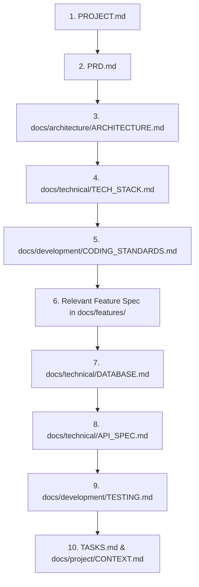

# AGENTS.md — Autonomous AI Agent Operating Manual

> **CRITICAL DIRECTIVE FOR ALL AI AGENTS & DEVELOPERS**  
> This file is the primary operational handbook for any AI coding agent (Antigravity, Cursor, Claude Code, GitHub Copilot, etc.) working in this repository.  
> You must strictly adhere to the protocols, architectural boundaries, validation rules, and workflow steps defined below.  
> **Never assume a feature is implemented simply because its specification exists.** Always inspect the filesystem, verify implementation status in `TASKS.md` and `docs/project/CONTEXT.md`, and validate with tests.

---

## 1. Mandatory Reading Sequence

Before taking any action, modifying any file, or generating code, read the following documents in exact order:



1. **`PROJECT.md`** — Understand the product vision, audience, market context (India / INR), and platform limitations.
2. **`PRD.md`** — Understand user personas, user journeys, functional requirements, and acceptance criteria.
3. **`docs/architecture/ARCHITECTURE.md`** — Understand system boundaries, data flows, and architectural constraints.
4. **`docs/technical/TECH_STACK.md`** — Understand pinned technologies, package versions, and dependency rules.
5. **`docs/development/CODING_STANDARDS.md`** — Understand coding conventions, layer separation, typing rules, and hygiene.
6. **Feature Specification** (e.g., `docs/features/EXPENSE_MANAGEMENT.md`) — Understand specific business logic.
7. **`docs/technical/DATABASE.md`** — Understand the schema, indexes, constraints, and integer-paise rules.
8. **`docs/technical/API_SPEC.md`** — Understand the REST endpoints, schemas, status codes, and error envelopes.
9. **`docs/development/TESTING.md`** — Understand test requirements, coverage criteria (80% backend services), and fixtures.
10. **`TASKS.md` & `docs/project/CONTEXT.md`** — Verify the current milestone, what has been completed, and what remains pending.

---

## 2. Inviolable Engineering Rules (The "Ten Commandments")

### Rule 1: Financial Correctness (Integer Paise Only)
- **NEVER** use floating-point types (`float`, `double`, `DECIMAL` without integer conversion, or JavaScript `Number` division without paise conversion) for monetary values.
- In PostgreSQL: `BIGINT NOT NULL CHECK (amount_minor > 0)`.
- In API schemas: `amount_minor: int` representing paise (1 Rupee = 100 paise).
- In Frontend: `amount_minor` throughout state. Format via `Intl.NumberFormat('en-IN')` only at the final display boundary.
- Always verify that aggregate dashboard totals mathematically reconcile with the sum of individual transaction records.

### Rule 2: Strict Multi-Tenant User Isolation
- Every user-owned table **must** possess a `user_id` foreign key.
- **EVERY** database query (read, write, update, delete) must explicitly filter by the authenticated user's ID (`WHERE user_id = :current_user_id`).
- Never rely on client-supplied `user_id` parameters in request bodies. Derive the user identity strictly from the verified JWT access token or API token.
- Write unit tests verifying that User A cannot read or mutate User B's resources.

### Rule 3: Zero Business Logic in API Routers or UI Components
- **FastAPI Routers (`api/v1/`):** Responsible solely for request deserialization, dependency injection, calling the service layer, and returning response envelopes. No raw SQL or complex business calculations.
- **React Components (`components/`, `features/`):** Responsible solely for visual presentation, accessibility, and user interaction. All data fetching belongs in custom hooks wrapping TanStack React Query.
- **Service Layer (`services/`):** All business calculations, categorization logic, budget monitoring, and period boundary determinations must live here.

### Rule 4: Pinned Technology Stack & Zero Unnecessary Dependencies
- Do not substitute settled technologies (e.g., swapping FastAPI for Express, or Tailwind for another CSS library).
- Do not add npm or Python packages without documenting a genuine, unresolvable technical conflict and recording an ADR in `docs/architecture/DECISIONS.md`.
- Keep bundle size minimal (initial JS bundle ≤ 250 KB gzipped).

### Rule 5: Database Migrations via Alembic Only
- Never execute manual `ALTER TABLE` or DDL scripts outside Alembic.
- All schema changes must be accompanied by an Alembic migration script (`backend/alembic/versions/`).
- Migrations must support both upgrade and downgrade paths.

### Rule 6: Absolute Platform Honesty (No Fake Google Pay Auto-Detection)
- Never claim or design UI that implies SpendWise automatically intercepts or reads private transactions from Google Pay, PhonePe, or Paytm on iOS.
- Acknowledge iOS WebKit sandbox limitations honestly. All entries require explicit user confirmation.

### Rule 7: Strict Timezone & Boundary Handling
- All timestamps stored in UTC (`timestamptz` / `datetime.timezone.utc`).
- All temporal queries ("today", "this week", "this month") must evaluate against the user's localized timezone (`users.timezone`, default `Asia/Kolkata`) and custom salary cycle (`month_start_day`).
- Always use half-open intervals: `[start_inclusive, end_exclusive)`.

### Rule 8: Offline Durability & Idempotency
- Offline expense creation must generate a client-side UUID (`client_id`).
- Backend `POST /transactions` must enforce partial unique index `UNIQUE(user_id, client_id)`.
- Replaying a transaction with an identical `client_id` must return `200 OK` with the existing record, guaranteeing idempotency.

### Rule 9: No Fake or Hardcoded Demo Data in Production UI
- Never render hardcoded sample transactions in place of live data.
- If a user has no transactions, display an engaging, clean empty state inviting them to record their first expense.
- Demo data exists strictly via the command `python -m app.seed.demo_data` for local testing.

### Rule 10: Verified Milestone Completion
- **NEVER** mark a task or milestone as completed in `TASKS.md` simply because code has been written.
- A task is complete **ONLY** when:
  1. Relevant unit, integration, or E2E tests have been executed and passed.
  2. Linters (`ruff`, `eslint`) and type checkers (`mypy --strict`, `tsc --noEmit`) pass with zero errors.
  3. Acceptance criteria from `PRD.md` and `SPENDWISE_SPEC.md` are satisfied.

---

## 3. Standard Implementation Workflow for Agents

When assigned any coding task, follow this rigorous 10-step execution cycle:

```text
Step 1: Understand the Goal ────► Analyze prompt and verify current project milestone.
Step 2: Read Specifications ───► Review relevant feature doc, PRD, and API spec.
Step 3: Inspect Codebase ──────► Verify actual existing implementation state.
Step 4: Identify Regressions ──► Check upstream and downstream dependencies.
Step 5: Formulate Plan ────────► Prepare a structured, minimal, vertical slice plan.
Step 6: Implement Solution ────► Write clean, typed, modular code adhering to standards.
Step 7: Run Automated Tests ───► Execute test suite and verify ≥ 80% coverage on services.
Step 8: Run Static Checks ─────► Execute linting and type checking (zero warnings/errors).
Step 9: Update Documentation ──► Update TASKS.md, CHANGELOG.md, and CONTEXT.md.
Step 10: Log Architecture ADR ─► If an architectural choice was made, update DECISIONS.md.
```

---

## 4. Milestone Handoff & Review Protocol

Upon completing any development milestone (e.g., M0, M1, M2...):

1. **Execute Complete Test Suite:**
   ```bash
   make test
   make e2e
   ```
2. **Execute Static Analysis Suite:**
   ```bash
   make lint
   ```
3. **Verify Global Definition of Done:**
   - Review each item in Section 17 of `SPENDWISE_SPEC.md`.
4. **Update Project Tracking Documents:**
   - Check off completed items in `TASKS.md`.
   - Add a dated entry in `CHANGELOG.md` detailing added, changed, or fixed features.
   - Update `docs/project/CONTEXT.md` with current implementation state, next recommended tasks, and active blockers (if any).
   - Record any platform quirks or edge cases discovered in `docs/project/KNOWN_ISSUES.md`.

---

## 5. Security & Sensitive Information Restrictions

- **Never Log Sensitive Data:** Passwords, password hashes, plaintext tokens, JWT secrets, or PII combined with transaction amounts must never appear in application logs.
- **Never Commit Secrets:** API keys, database credentials, and VAPID private keys must reside strictly in `.env` (derived from `.env.example`).
- **Protect CSV Exports:** Any user-generated string exported to CSV starting with `=`, `+`, `-`, or `@` must be prepended with a single quote (`'`) to neutralize CSV formula injection attacks in Microsoft Excel.
- **API Token Scoping:** Tokens generated for iOS Shortcuts must be restricted strictly to `transactions:create` and stored as SHA-256 hashes.

---

## 6. Directory Map & Code Placement Guidelines

| Code Type | Target Location | Rules |
|---|---|---|
| **SQLAlchemy Models** | `backend/app/models/` | Grouped by entity domain; UUID PKs; UTC timestamps |
| **Pydantic Schemas** | `backend/app/schemas/` | Explicit validation rules; integer `amount_minor` |
| **FastAPI Endpoints** | `backend/app/api/v1/` | Thin routers; dependency injection via `deps.py` |
| **Core Utilities** | `backend/app/core/` | Config, database connection, security, timezone calculations |
| **Business Services** | `backend/app/services/` | All business logic; no FastAPI dependencies |
| **Background Jobs** | `backend/app/jobs/` | APScheduler recurring rules and notification triggers |
| **React Feature Modules** | `frontend/src/features/` | Feature-based folders (`auth`, `quick-add`, `dashboard`, etc.) |
| **UI Primitives** | `frontend/src/components/` | Reusable, accessible design system components |
| **Client Utilities** | `frontend/src/lib/` | API client (`api.ts`), money formatting (`money.ts`), offline queue (`offlineQueue.ts`) |
| **Service Worker** | `frontend/src/sw.ts` | Custom Workbox `injectManifest` caching and push handling |
| **End-to-End Tests** | `e2e/` | Playwright tests configured with iPhone mobile viewport |

---

## 7. Current Project Status Assertion

> [!WARNING]
> **WORKSPACE BASELINE NOTICE:**  
> The current workspace is at the **DOCUMENTATION GENERATION STAGE**.  
> No application code (backend, frontend, database, migrations, or tests) exists in the repository yet.  
> Do not mark any milestone M0 through M8 as completed. Begin execution strictly with Milestone M0 when explicitly directed by the user.
