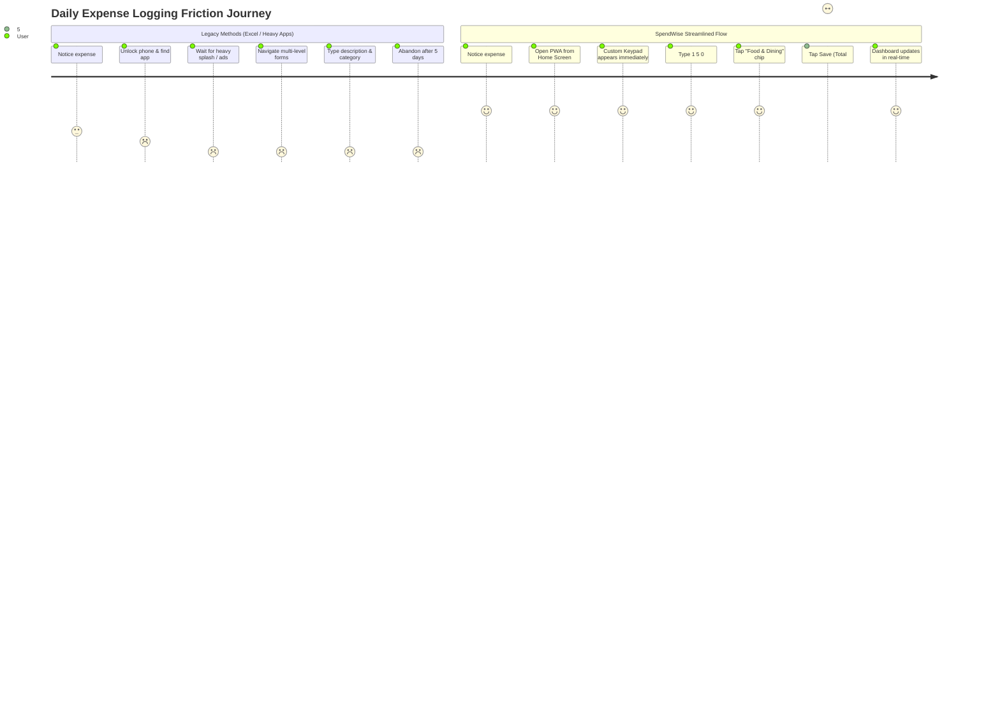

# SpendWise — Product Requirements Document (PRD)

## 1. Document Control & Metadata
- **Product Name:** SpendWise
- **Document Version:** 1.0.0
- **Document Status:** Approved / Settled
- **Target Release:** v1.0 (MVP + Phase 2)
- **Primary Market:** India (Currency: INR ₹, Locale: `en-IN`, Timezone: `Asia/Kolkata`)
- **Primary Device:** iPhone (iOS Safari & Standalone PWA), Desktop secondary

---

## 2. Product Goals & Objectives

### 2.1 Strategic Objectives
1. **Minimize Transaction-Entry Friction:** Enable users to log an everyday expense in **5–10 seconds** and within **≤ 3 taps** after entering the amount on a custom numeric keypad.
2. **Deliver Immediate Financial Visibility:** Provide an instant, transparent snapshot of today's, this week's, and this month's spending upon opening the application.
3. **Guarantee Absolute Financial Accuracy:** Enforce integer-based paise accounting throughout the stack (`BIGINT` / `amount_minor`), eliminating floating-point rounding errors.
4. **Provide Uninterrupted Offline Utility:** Guarantee that poor or nonexistent mobile connectivity never causes a transaction failure or data loss.
5. **Empower Data Ownership:** Enable effortless bulk onboarding via CSV statement import and complete financial data portability via multi-sheet Excel (`.xlsx`) and CSV export.

---

## 3. User Personas

### Persona A: "Priya" — The Fast-Paced Metro Professional
- **Demographics:** 28 years old, Software Engineer in Bengaluru.
- **Financial Profile:** High frequency of daily micro-transactions via UPI (auto-rickshaw, office cafeteria, quick-commerce groceries, evening coffee).
- **Core Frustration:** Tried maintaining an Excel sheet twice; abandoned it each time within 10 days because entering every ₹40 or ₹150 purchase on a laptop is exhausting.
- **SpendWise Use Case:** Pulls out her iPhone after tapping her UPI PIN at a café, taps the SpendWise Home Screen icon, types `1 5 0`, taps the `Food & Dining` chip, taps `Save`. Total time: 6 seconds.

### Persona B: "Rahul" — The Budget-Conscious Freelancer
- **Demographics:** 34 years old, UI/UX Designer in Mumbai.
- **Financial Profile:** Variable monthly income, paying several digital tool subscriptions, rent, and utility bills.
- **Core Frustration:** Experiences end-of-month anxiety when discovering account balances are unexpectedly depleted.
- **SpendWise Use Case:** Sets a monthly overall budget of ₹45,000 and specific category budgets for Dining and Electronics. Monitors his dashboard progress rings and relies on proactive notifications when 80% of a budget is reached. Uses CSV import at the end of each month to reconcile bank statements.

---

## 4. User Problems & User Journeys

### 4.1 Friction Analysis

### 4.2 End-to-End User Journey: Everyday Payment Logging
1. **Trigger:** User completes a ₹220 payment for an auto ride via Google Pay.
2. **Access:** User closes Google Pay. An iOS Shortcut automation prompts to open SpendWise, or user taps the SpendWise Home Screen icon.
3. **Capture:** SpendWise launches instantly in PWA standalone mode directly into `/add`.
4. **Input:**
   - User types `2 2 0` on the custom numeric keypad.
   - The category chip bar highlights `Transportation` (top-ranked by 30-day frequency).
   - User taps `Transportation`. Optional subcategories (`Cab`, `Auto`, `Fuel`) animate in; user taps `Auto` (or leaves it unselected).
   - Payment method defaults to `UPI`.
5. **Confirmation:** User taps `Save ₹220`.
6. **Feedback:** A floating toast appears: *"₹220 added to Transportation · Undo"*. The user is returned to the dashboard where "Today" and "Monthly" totals reflect the new amount instantly.

---

## 5. Prioritization Matrix (P0 / P1 / P2)

| Priority | Definition | Features Included |
|---|---|---|
| **P0 (Critical MVP)** | Essential for core utility, data integrity, and launch | Auth (JWT/Argon2), Custom Keypad Quick Add, Integer Paise Engine, Category Tree, Dashboard & Visual Analytics, History & Filters, IndexedDB Offline Queue, PWA Standalone |
| **P1 (Core Experience)** | Necessary for sustainable user engagement | Monthly & Category Budgets, Recurring Expenses Engine, CSV Statement Import & Deduplication, CSV/Excel Export, Rule-Based Insights, Web Push Notifications, iOS Shortcuts Mode A/B |
| **P2 (Enhancements)** | Polish and advanced customization | Category drag-reorder, Bulk transaction actions, Salary cycle customization (`month_start_day`), Dark/Light system theme toggle |
| **Future (Phases 3 & 4)** | Advanced intelligence and deep ecosystem | Spending predictions, Anomaly detection, Subscription detection, Multi-account wallets, Account Aggregator, Natural language query assistant |

---

## 6. Functional Requirements & Feature Specifications

### 6.1 Feature: Quick Expense Entry (`/add`)
- **Priority:** P0 (MVP Critical)
- **1. What it does:** Provides a lightning-fast single-screen interface for logging expenses with an embedded custom keypad and contextual chips.
- **2. Why it exists:** Minimizes input friction, eliminating the primary cause of personal finance tracking abandonment.
- **3. Who uses it:** Every user, multiple times daily.
- **4. How it works:**
  - Keypad inputs amount up to 2 decimal places.
  - Dynamically displays top-5 categories ordered by rolling 30-day frequency (`usage_count_30d`), plus a "More" trigger.
  - Selecting a category reveals optional subcategory chips.
  - Allows optional merchant/notes and payment method overrides.
  - Generates client-side UUID for idempotency.
- **5. Expected Behavior:** Save button displays dynamic text: `Save ₹{formatted_amount}`. Enabled strictly when amount > 0 and category is chosen. Saves optimistically and exhibits an undo toast (5-second window).
- **6. Validation Rules:**
  - Amount must be integer paise > 0 and ≤ 1,000,000,000 paise (₹1,00,00,000 / 10 crore).
  - Maximum 2 decimal points allowed on input.
  - Category ID is mandatory and must belong to the active user.
  - Subcategory ID must have `parent_id == category_id`.
  - `occurred_at` timestamp cannot exceed current server UTC time + 5 minutes.
- **7. Error Scenarios:**
  - Network disconnected: Item is stored in IndexedDB `pending_transactions` store with a pending clock badge; toast displays *"Saved offline"*.
  - Duplicate client ID: Server responds with `200 OK` returning existing record without duplicate insertion.
- **8. Acceptance Criteria:**
  - Complete entry flow takes ≤ 3 taps after typing the number.
  - Custom keypad inputs responsive without virtual keyboard interference.

---

### 6.2 Feature: Dashboard & Visual Analytics (`/` & `/analytics`)
- **Priority:** P0 (MVP Critical)
- **1. What it does:** Presents an executive financial summary (Today, This Week, This Month, Remaining Budget), visual category breakdowns (Donut chart), daily spending trends (Area/Bar charts), and rule-based insights.
- **2. Why it exists:** Delivers immediate clarity on spending pace and category distribution without requiring users to build reports.
- **3. Who uses it:** All users checking daily progress or conducting weekly/monthly reviews.
- **4. How it works:**
  - Backend `/analytics/summary` aggregates totals using the user's localized timezone (`Asia/Kolkata`) and month boundary (`month_start_day`).
  - Recharts renders responsive Donut and Trend charts with category color assignments.
  - An accessible data table toggle is provided for screen readers and tabular review.
- **5. Expected Behavior:** Pull-to-refresh invalidates cache and triggers background refetching. Zero transactions displays a clean empty state inviting the first expense.
- **6. Business Rules:**
  - Sum of categorized amounts must mathematically reconcile with total period expenditure.
  - Missing days in trend charts must be zero-filled to maintain temporal accuracy.
  - "Compare to previous period" must compare identical elapsed day counts (e.g., Nov 1–12 vs Oct 1–12) to avoid false variances.
- **7. Acceptance Criteria:**
  - Dashboard renders in < 1.5s on mobile 4G.
  - Analytics p95 query latency is < 300ms across 50,000 transaction records.

---

### 6.3 Feature: Budget Management (`/budgets`)
- **Priority:** P1
- **1. What it does:** Allows users to define overall monthly spending ceilings and category-specific allowances with automated threshold alerts.
- **2. Why it exists:** Transforms passive tracking into proactive financial behavior modification.
- **3. Who uses it:** Users seeking to curb discretionary spending (e.g., Dining out, Shopping).
- **4. How it works:**
  - User defines `amount_minor` and an alert threshold percentage (default 80%, slider range 50–100%).
  - Real-time spend tracking evaluates transactions falling within the user's current period.
  - Calculates `safe_daily_minor = max(remaining, 0) / days_left`.
- **5. Visual States:**
  - `ok`: Spend < alert threshold (Green / Theme primary).
  - `warning`: Spend ≥ alert threshold and < 100% (Amber / Warning).
  - `exceeded`: Spend ≥ 100% (Red / Destructive).
- **6. Error & Alert Scenarios:**
  - When a transaction pushes spending over the threshold or 100%, an alert is dispatched via Web Push and recorded in `notification_log` with a composite dedupe key (`budget_id + period_start + level`) to prevent alert spam.
- **7. Acceptance Criteria:**
  - Budget calculations reflect mid-period budget creation immediately.
  - Changing month start day dynamically shifts budget evaluation boundaries.

---

### 6.4 Feature: Recurring Expenses Engine (`/recurring`)
- **Priority:** P1
- **1. What it does:** Manages recurring commitments (Rent, Electricity, Subscriptions, EMIs) with automated logging or interactive confirmation prompts.
- **2. Why it exists:** Eliminates manual re-entry of predictable fixed expenses.
- **3. How it works:**
  - Rules define frequency (`daily`, `weekly`, `monthly`, `yearly`), intervals, and execution mode (`auto_create` vs `remind`).
  - APScheduler hourly job evaluates due rules relative to the user's local timezone.
  - `auto_create` mode creates transactions at 09:00 user-local on the due date.
  - `remind` mode surfaces a "Due Recurring Expenses" action card on the Dashboard.
- **4. Business Rules:**
  - Monthly rules anchored on the 29th, 30th, or 31st automatically clamp to the last day of shorter months (e.g., Feb 28/29).
  - Idempotent catch-up ensures no missed runs if the server was offline, capping catch-up at 12 cycles per run.
- **5. Acceptance Criteria:**
  - Confirming a recurring card generates a transaction with `source=recurring` and advances `next_due_date`.
  - Skipping advances `next_due_date` without creating a transaction.

---

### 6.5 Feature: CSV Statement Import & Deduplication (`/import`)
- **Priority:** P1
- **1. What it does:** 3-step import wizard for bank and payment statements with automatic dialect detection, column mapping, and duplicate prevention.
- **2. Why it exists:** Solves the historical data onboarding problem and facilitates reconciliation.
- **3. How it works:**
  - Step 1: Upload file (≤ 2 MB, ≤ 5,000 rows). Server sniffs delimiter (comma, semicolon, tab), encoding (UTF-8, UTF-8-BOM, Latin-1), and date format (`DD/MM/YYYY`, `YYYY-MM-DD`, etc.).
  - Step 2: User maps columns (Date, Amount, Description). Supports signed amounts or debit/credit column splits.
  - Step 3: Review table with suggestion badges. Highlights detected duplicates (`sha256(user_id | date | amount | normalized_desc)`).
  - Commit executes within an atomic database transaction.
- **4. Safety & Rollback:**
  - The entire batch can be undone via `DELETE /imports/{id}`, which soft-deletes all associated transactions.
- **5. Acceptance Criteria:**
  - Correctly parses standard HDFC, SBI, ICICI, and Google Pay CSV statements.
  - Zero partial imports on validation failure.

---

### 6.6 Feature: Offline PWA & Background Sync
- **Priority:** P0 (MVP Critical)
- **1. What it does:** Ensures full transaction creation capabilities when disconnected from the internet and synchronizes data when connectivity resumes.
- **2. Why it exists:** Digital payments often happen in underground basements, parking lots, or remote shops where mobile networks fail.
- **3. How it works:**
  - Service worker precaches the entire application shell (HTML, CSS, JS, icons).
  - React Query cache is persisted to IndexedDB.
  - Disconnected POST requests are captured and stored in IndexedDB `pending_transactions`.
  - Synced sequentially upon `online`, `visibilitychange`, and app restart events.
- **4. Constraints & Acceptance Criteria:**
  - Offline mode supports transaction creation only; edits and deletes display an informative "Connect to internet" dialog in v1.
  - Duplicate submissions are completely mitigated by `client_id` unique constraint.

---

### 6.7 Feature: iOS Shortcuts Integration
- **Priority:** P1
- **1. What it does:** Provides frictionless workflows directly from iOS native automation.
- **2. Modes:**
  - **Mode A (Deep Link):** Personal automation opening `https://app.spendwise.in/add?amount=150&category=Food&source=shortcut`.
  - **Mode B (Headless API):** Direct background `POST /api/v1/shortcuts/transactions` using a scoped API token (`sw_...`).
- **3. Platform Honesty:**
  - Explicitly documents that iOS does not allow automated silent reading of Google Pay transaction details. User confirmation is always required.
- **4. Acceptance Criteria:**
  - API tokens are displayed once upon creation and stored hashed (`SHA-256`).
  - Mode B returns clean, concise confirmation text formatted for native iOS notifications (e.g., *"₹150 added to Food & Dining"*).

---

## 7. Business Rules Matrix

| Rule ID | Domain | Rule Definition | Enforcement Layer |
|---|---|---|---|
| **BR-FIN-001** | Money | Monetary values must strictly be positive integers in minor units (paise). Floats are strictly prohibited. | Pydantic Schema & PostgreSQL `CHECK (amount_minor > 0)` |
| **BR-FIN-002** | Formatting | All currency representations must use the `en-IN` numbering system (lakh/crore commas: `₹1,25,000`). | Frontend `lib/money.ts` |
| **BR-SEC-001** | Isolation | Every database query accessing tenant data must include `user_id == current_user.id`. | SQLAlchemy Repository & Service Layer |
| **BR-TIM-001** | Timezones | All timestamps stored in UTC. Period bounds (`day`, `week`, `month`) must be evaluated in the user's configured timezone. | `backend/app/core/time.py` |
| **BR-TIM-002** | Time Boundaries | Reporting date intervals must use half-open ranges: `[start_inclusive, end_exclusive)`. | Service Layer Queries |
| **BR-CAT-001** | Categories | Category hierarchy is restricted to a maximum depth of 2 (Category → Subcategory). | Service Layer `categories.py` |
| **BR-CAT-002** | Categories | Default categories seeded at signup cannot be deleted; they may only be archived or renamed. | Service Layer `categories.py` |
| **BR-TXN-001** | Transactions | `occurred_at` timestamps cannot be more than 5 minutes in the future relative to server UTC time. | Pydantic Validator |
| **BR-IMP-001** | Import | Credit (income) transactions are skipped by default in CSV import, keeping the focus on expense tracking. | `csv_import.py` Service |
| **BR-SEC-002** | Export | All exported CSV files must escape formula injection characters (`=`, `+`, `-`, `@`) by prepending a single quote (`'`). | `exports.py` Service |

---

## 8. Edge Cases & Handling Strategy

1. **Leap Years & Month Boundary Shifts:**
   - Recurring rules set on the 31st of each month evaluate to Feb 28 (or Feb 29 in leap years). Handled by Python `dateutil.relativedelta` or explicit day clamping.
2. **Salary-Based Fiscal Cycles:**
   - For users with `month_start_day = 25`, the month of November spans from Oct 25 00:00:00 to Nov 24 23:59:59. All summary endpoints dynamically re-anchor based on this setting.
3. **Flaky Network During Quick Add:**
   - If the network drops while the user taps `Save`, the client timeout intercepts the request, stores the payload in IndexedDB with its original `client_id`, updates the local UI optimistically, and syncs automatically when the connection is restored.
4. **Token Expiration in iOS Standalone PWA:**
   - iOS PWA reloads from cold storage without active cookies. Refresh tokens stored securely in `localStorage` trigger a silent token rotation on app launch before rendering protected routes.
5. **Simultaneous Identical Purchases:**
   - If a user buys two identical ₹40 coffees on the same day, duplicate detection flags identical within-file rows as *informational* warnings rather than hard errors, while blocking rows matching existing database records.

---

## 9. Non-Functional Acceptance Criteria

1. **Lighthouse Audit:** Score ≥ 90 in PWA, Accessibility, and Best Practices on the root dashboard route.
2. **Offline Resilience:** Disconnecting Wi-Fi/cellular, creating an expense, closing the browser, reconnecting, and reopening must result in 100% sync success with zero duplicates.
3. **Backend Test Coverage:** Minimum 80% line coverage across all backend business logic services (`services/`).
4. **Clean Code & Strict Typing:** Zero TypeScript compiler errors (`tsc --noEmit`), zero ESLint errors, zero Ruff lint errors, and zero mypy type errors in `--strict` mode.
