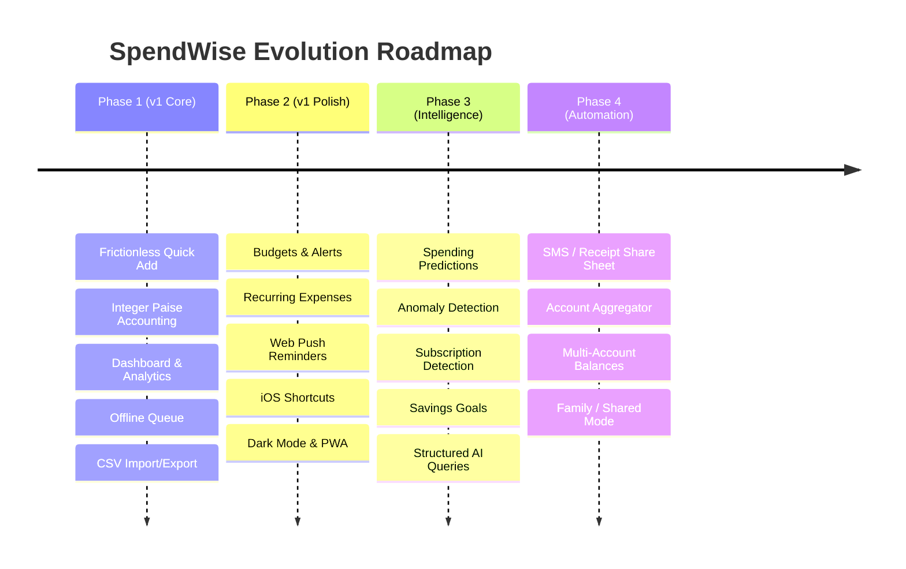
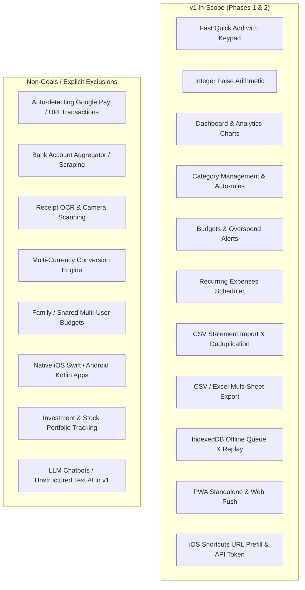

# SpendWise — Project Definition & Overview

## 1. Project Introduction

**SpendWise** is a mobile-first personal expense tracking and financial intelligence Progressive Web Application (PWA) designed primarily for iPhone users in India. 

In a daily financial environment dominated by fast digital micropayments (UPI via Google Pay, PhonePe, Paytm, debit/credit cards, and cash), individuals frequently lose track of daily cumulative spending. Traditional personal finance solutions—such as spreadsheets (Microsoft Excel, Google Sheets) or physical notebooks—suffer from high abandonment rates because manual transaction logging is cumbersome, time-consuming, and friction-heavy.

SpendWise addresses this fundamental friction by providing an ultra-fast transaction entry experience (target: **5–10 seconds, ≤ 3 taps after amount entry**), strict financial arithmetic correctness (integer paise, zero floating-point error), offline resilience via IndexedDB, and instant actionable spending analytics (daily, weekly, monthly totals, category breakdowns, budgets, and deterministic rule-based insights).

SpendWise adheres to the core operating philosophy:
> **Spend less time recording expenses and more time understanding your money.**

---

## 2. Problem Statement

Modern consumer spending in India is characterized by high transaction frequency and low individual transaction friction:
- ₹80 for an auto-rickshaw commute.
- ₹150 for lunch at a café.
- ₹40 for afternoon tea and snacks.
- ₹350 for on-demand grocery delivery (Blinkit, Zepto, Instamart).
- ₹120 for an evening cab ride.

Because digital payments succeed in seconds via QR code scans and UPI PIN entry, consumers experience cognitive detachment from cash outflows. At the end of a day, week, or month, users lack visibility into:
1. Total actual money spent across payment channels.
2. The specific categories consuming disproportionate proportions of income.
3. The pace of expenditure relative to an informal or formal monthly budget limit.

### Why Existing Solutions Fail
- **Spreadsheets & Notebooks:** Require manual categorization, manual date logging, and manual formula maintenance. Users abandon them within days due to input friction.
- **Traditional Heavy Finance Apps:** Over-engineered with multi-step wizards, account aggregator linking complexities, intrusive advertising, slow startup times, or foreign currency models.
- **SMS-Reading Android Trackers:** Do not work on iOS due to Apple's strict sandboxing and security model.

The core problem is **transaction-entry friction** combined with a lack of **localized, immediate financial feedback**.

---

## 3. Proposed Solution

SpendWise provides an uncompromisingly streamlined, mobile-first web application that functions as an installed PWA on iOS (Safari Add to Home Screen):

1. **Frictionless Quick Entry (`/add`):**
   - Custom in-app numeric keypad eliminating mobile keyboard pop-up latency.
   - Dynamic top-5 frequently used category chips based on a 30-day rolling usage counter.
   - Smart auto-categorization based on user-defined and learned merchant patterns.
   - Minimal mandatory fields: **Amount** and **Category**. Everything else (merchant, subcategory, payment method, notes, custom timestamp) is optional.
2. **Instant Financial Intelligence:**
   - Real-time dashboard showing today's spend, week-to-date spend, month-to-date spend, and overall budget burn rate.
   - Visual category distribution donut charts and daily trend bar/area charts powered by Recharts.
   - Deterministic, rule-based insights (e.g., weekend spend spikes, category increases vs. prior period) with zero external LLM dependencies in v1.
3. **Financial Correctness:**
   - All monetary figures stored and computed internally as 64-bit integer paise (`BIGINT` / `amount_minor`).
   - Formatting strictly localized to Indian English (`en-IN` numbering: ₹1,25,000.00).
   - Timezone-aware date boundary calculations centered on `Asia/Kolkata` and configurable user salary cycles (`month_start_day`).
4. **Offline Capability & Reliability:**
   - Full offline transaction creation via IndexedDB (`idb`) queue with client-generated UUIDs (`client_id`).
   - Automatic background synchronization upon network reconnection with idempotent replay.
5. **Statement Import & Export:**
   - 3-step CSV statement import wizard with automatic delimiter, encoding, and date format detection.
   - Deduplication hashing and one-click rollback/undo.
   - Comprehensive CSV and Excel (`.xlsx`) export with summary sheets.
6. **Platform Integration:**
   - iOS Shortcuts integration allowing one-tap launching of pre-filled Quick Add screens or headless API transaction logging via scoped API tokens.

---

## 4. Product Vision & Roadmap

SpendWise is developed across deliberate, phased milestones:

- **v1 Focus:** Rock-solid manual quick entry, CSV import, reliable local calculations, offline safety, and mobile UX.
- **Future Phases (Scaffolded in DB Schema):** Predictive modeling, anomaly detection, multi-wallet accounts (`accounts` table), and savings targets (`goals` table).

---

## 5. Target Audience & Market Profile

### 5.1 Primary User Persona
- **Role:** Individual working professional, freelancer, or student managing personal finances.
- **Behavior:** Daily user of digital UPI apps (Google Pay, PhonePe, Paytm, CRED, Navi) and card payments.
- **Needs:** Fast expense logging without having to connect bank credentials or enter banking passwords.
- **Pain Point:** Finds standard expense apps too complex and spreadsheets too tedious.

*Note for v1:* SpendWise v1 strictly targets **individuals tracking their own expenses**. Multi-user shared budgets, split payments, and family accounts are explicitly deferred to future phases, though the database schema enforces strict multi-tenant user isolation.

### 5.2 Regional & Market Specifications
- **Jurisdiction & Locale:** India (`en-IN`).
- **Currency:** Indian Rupee (INR, symbol: `₹`, ISO: `INR`).
- **Base Unit:** 1 Rupee = 100 Paise. Stored as integer paise.
- **Primary Timezone:** `Asia/Kolkata` (UTC+05:30).
- **Payment Ecosystem:** UPI, Cash, Credit/Debit Card, Net Banking / Bank Transfer, Other.

---

## 6. Core Product Capabilities

| Capability | Specification | v1 Status |
|---|---|---|
| **Quick Expense Logging** | Custom numeric keypad, top frequent category chips, subcategory selection, optional merchant/notes, default payment method | **In Scope (P0)** |
| **Financial Calculations** | Exact integer arithmetic in paise (`BIGINT`), zero floating point errors, half-open time boundaries `[start, end)` | **In Scope (P0)** |
| **Dashboard Analytics** | Today, this week, this month totals, remaining budget, category donut chart, daily spending bar/area chart | **In Scope (P0)** |
| **History & Search** | Full-text and trigram search (`pg_trgm`), multi-attribute filtering (category, payment method, date range, amount), cursor pagination | **In Scope (P0)** |
| **Budget Management** | Overall monthly budget and category-specific budgets, alert thresholds (default 80%), visual status (ok, warning, exceeded) | **In Scope (P0)** |
| **Recurring Expenses** | Schedule rules (daily, weekly, monthly, yearly), auto-create or remind mode, catch-up idempotency | **In Scope (P1)** |
| **CSV / Excel Import** | Multi-format CSV parser, automatic delimiter/encoding detection, column mapping wizard, duplicate detection, atomic commit & undo | **In Scope (P1)** |
| **CSV / Excel Export** | Excel `.xlsx` multi-sheet workbook (Transactions, Category Summary, Monthly Summary) and UTF-8 CSV with formula injection defense | **In Scope (P1)** |
| **Spending Insights** | Rule-based deterministic insights (11 distinct heuristics), zero LLM dependency | **In Scope (P1)** |
| **Offline PWA** | Installable on iOS Safari, service worker shell caching, IndexedDB transaction queue, automatic idempotent replay | **In Scope (P0)** |
| **iOS Shortcuts** | Mode A (URL deep-link with prefill query params) and Mode B (headless direct POST with scoped API tokens) | **In Scope (P1)** |
| **Web Push Reminders** | Daily logging reminder if 0 transactions recorded, budget threshold alerts via Web Push (VAPID) | **In Scope (P1)** |
| **AI Assistant / LLM** | Natural language queries, conversational analytics | *Out of Scope (Phase 3)* |
| **Auto-reading UPI Apps**| Background interception of Google Pay/PhonePe transactions | *Impossible / Non-Goal* |

---

## 7. Functional Requirements Summary

1. **Authentication & Identity:**
   - Registration and login via email and password (minimum 8 characters).
   - Password hashing with Argon2id (`argon2-cffi`).
   - Short-lived JWT access tokens (15 minutes) and rotating refresh tokens (30 days) stored hashed in PostgreSQL.
   - User profile configuration: Timezone, currency, week start day (Monday–Sunday), month start day (1–28 for salary cycles), default payment method, reminder time.
2. **Category Management:**
   - Seeded default categories with Lucide icon names and hex color codes.
   - Support for 2-level hierarchy: Parent category → Subcategories (maximum depth = 2).
   - Custom user category creation, editing, color/icon updates, and soft archiving.
   - Auto-categorization rule management (merchant string substring match).
3. **Transaction Processing:**
   - Capture `amount_minor` (> 0), `category_id`, optional `subcategory_id`, `merchant`, `description`, `notes`, `payment_method`, `occurred_at`, `source`, and `client_id`.
   - Prevent transaction timestamps greater than current server time + 5 minutes.
   - Soft-deletion with undo capabilities (`deleted_at` timestamp).
   - Client-side idempotency tracking using `client_id` (UUID).
4. **Analytics & Reporting:**
   - Aggregations grouped by user-configured timezone and salary month start day.
   - Zero-filled trend series for consistent visual charting.
   - Category spend comparisons between current period and equivalent elapsed days of previous period.
5. **Budgets & Notifications:**
   - Real-time comparison of actual expenditure against defined limits.
   - In-app warning banners and Web Push notifications dispatched once per threshold crossing.

---

## 8. Non-Functional Requirements

### 8.1 Performance & Responsiveness
- **First Contentful Paint (FCP):** < 1.5 seconds on a mid-tier 4G mobile device; < 0.5 seconds for cached PWA shell.
- **Quick Add Interactivity:** Input-ready in < 300 ms upon tapping the `+ Add` button.
- **Analytics Query Latency:** 95th percentile (p95) < 300 ms for a database containing 50,000 transactions per user.
- **Client Bundle Size:** Initial gzipped JavaScript bundle ≤ 250 KB (routes and heavy charting libraries lazily loaded).

### 8.2 Security & Data Privacy
- **User Isolation:** 100% of queries accessing user-owned tables must enforce `WHERE user_id = :current_user_id`. Cross-user data leakage is a critical severity failure.
- **Credential Storage:** Argon2id password hashing; SHA-256 token hashing for stored refresh tokens and API tokens.
- **Injection Defenses:** Parameterized ORM queries (SQLAlchemy 2.0); strict CSV export formula sanitization (escaping cells starting with `=`, `+`, `-`, `@`).
- **Network Security:** Strict HTTPS enforcement in production; CORS locked to `FRONTEND_ORIGIN`; hardened HTTP headers (`X-Content-Type-Options: nosniff`, `Referrer-Policy: strict-origin-when-cross-origin`).

### 8.3 Reliability & Offline Resilience
- **Zero Financial Discrepancies:** All database updates for bulk operations (e.g., CSV imports) execute inside atomic database transactions.
- **Offline Integrity:** Transactions queued offline must never be lost or duplicated. Replay mechanism must handle intermittent network connectivity gracefully.

### 8.4 Usability & Accessibility
- **Touch Target Sizing:** Minimum 44 × 44 pt touch targets across all mobile interface elements.
- **Color Contrast:** WCAG AA conformance for all text and interactive UI elements.
- **Data Table Fallbacks:** All graphical charts (Recharts) provide an accessible table alternative toggle.

---

## 9. Product Scope: v1 In-Scope vs. Non-Goals

---

## 10. Platform Limitations & Technical Constraints

### 10.1 iOS PWA Sandboxing & UPI Detection
> [!CRITICAL]
> **Hard Technical Limitation:** An iOS Progressive Web App running in Safari or standalone Home Screen mode operates within Apple's WebKit sandbox. It **cannot** read SMS messages, inspect notifications from other applications, or access transaction history from Google Pay, PhonePe, or Paytm. 
> 
> SpendWise **never claims or implies automated payment detection**. All transaction creation requires explicit user confirmation.

### 10.2 Supported Friction-Reduction Integrations
To bridge the gap without violating platform constraints:
1. **iOS Personal Automation (Shortcut):** Triggered when Google Pay, PhonePe, or Paytm is closed, launching `https://app.spendwise.in/add?source=shortcut`.
2. **URL Parameter Prefill:** Allows external shortcuts or launchers to pass pre-filled amounts or categories (e.g., `/add?amount=150&category=Food`).
3. **Restricted Headless API:** `POST /api/v1/shortcuts/transactions` using a restricted personal API token (`sw_...`) for advanced Shortcut workflows.

### 10.3 Web Push on iOS
- Apple requires iOS / iPadOS 16.4 or later.
- Web Push functions **only** when the application is added to the Home Screen (PWA standalone mode).
- Push notification subscription requires an explicit user gesture (button tap in settings).

---

## 11. Success Metrics

1. **Logging Velocity:** Average time to log an expense is ≤ 8 seconds from app launch.
2. **Logging Consistency:** ≥ 70% of active users maintain a 7-day logging streak.
3. **Data Integrity:** 0 financial calculation bugs or floating-point rounding errors reported.
4. **Offline Durability:** 100% of offline-created transactions successfully sync without duplicate creation.
5. **PWA Adoption:** ≥ 60% of recurring mobile users install SpendWise to their iOS Home Screen.

---

## 12. Project Assumptions

1. Users possess a modern smartphone (primarily iPhone iOS 16.4+) with Safari browser access.
2. The user has an active internet connection for initial registration, category syncing, and periodic offline queue flushing.
3. Users are willing to dedicate 5–10 seconds per transaction or utilize CSV statement imports for historical bulk data.
4. Server infrastructure provides standard PostgreSQL 16 and a Python 3.12 asynchronous runtime.
