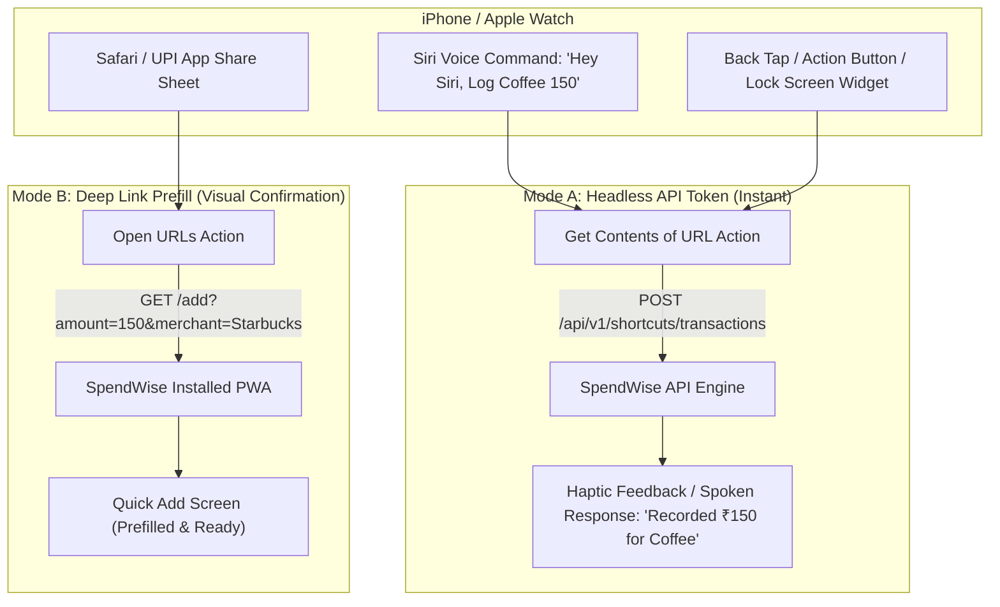

# SpendWise — iOS Shortcuts & Automation User Guide

SpendWise offers two powerful integration options with Apple iOS Shortcuts for 1-tap and voice-driven expense logging on iPhone, iPad, and Apple Watch.

---

## Architecture Overview

---

## Mode A: Headless Voice & Siri Shortcuts (Instant Background Entry)

Mode A logs expenses directly into SpendWise via the background REST API without opening your browser.

### Prerequisites
1. Navigate to **More** (`/more`) → **Push Notifications & Shortcuts** → **iOS Shortcuts & API Tokens** (`/settings/shortcuts`).
2. Tap **Generate Token**, enter a name (e.g. `iPhone 17 Siri`), and copy your unique secret token (`sw_...`).
   > [!IMPORTANT]
   > The plaintext `sw_...` token is displayed only once. Store it in a secure location or paste it immediately into your iOS Shortcut.

### iOS Shortcut Step-by-Step Configuration
1. Open the native **Shortcuts** app on your iPhone.
2. Tap **+** (top-right) to create a new Shortcut. Name it **"Log Expense"**.
3. Add the following actions in exact order:
   - **Ask for Input**:
     - Prompt: *"How much did you spend?"*
     - Input Type: **Number**
   - **Ask for Input**:
     - Prompt: *"Where or for what?"*
     - Input Type: **Text**
   - **Get Contents of URL**:
     - URL: `https://<your-spendwise-host>/api/v1/shortcuts/transactions`
     - Method: `POST`
     - Headers:
       - `Authorization`: `Bearer sw_<YOUR_PERSONAL_API_TOKEN>`
       - `Content-Type`: `application/json`
     - Request Body: `JSON`
       - Key `amount` → Select Variable `Provided Input (Number)`
       - Key `merchant` → Select Variable `Provided Input (Text)`
       - Key `payment_method` → Text `upi`
   - **Show Notification** or **Vibrate Device**:
     - Message: *"Recorded ₹[Provided Input] for [Provided Input]"*

### Siri Voice Trigger
Say: **"Hey Siri, Log Expense"**  
Siri will prompt for the amount and merchant, then silently save the transaction and provide confirmation.

---

## Mode B: Deep Link Prefill (Zero Setup, Visual Review)

Mode B opens the SpendWise PWA directly to the Quick Add screen with amount, merchant, and category prefilled, ready for you to confirm with a single tap.

### Supported URL Parameters

| Parameter | Type | Description | Example |
|---|---|---|---|
| `amount` | Number | Expense amount in Rupees | `250`, `1500.50` |
| `merchant` | Text | Store, restaurant, or payee | `Swiggy`, `Uber`, `Airtel` |
| `category` | Text | Category name or UUID (case-insensitive fuzzy match) | `Food & Dining`, `Groceries` |
| `pm` | Text | Payment method (`upi`, `card`, `cash`, `netbanking`) | `upi` |
| `note` | Text | Transaction notes or remarks | `Dinner with team` |

### Example Deep Links
- **Coffee Break**:  
  `https://<your-spendwise-host>/add?amount=240&merchant=Starbucks&category=Food%20%26%20Dining&pm=card`
- **Cab Ride**:  
  `https://<your-spendwise-host>/add?amount=350&merchant=Uber&category=Transportation&pm=upi`
- **Groceries**:  
  `https://<your-spendwise-host>/add?amount=1250&merchant=Blinkit&category=Groceries&pm=upi`

### iOS Shortcut Configuration for Mode B
1. In the **Shortcuts** app, create a new Shortcut named **"Quick Spend"**.
2. Add action: **URL**:
   - `https://<your-spendwise-host>/add?amount=[Shortcut Input]&merchant=Quick`
3. Add action: **Open URLs**:
   - Target: `URL`
4. Tap **Done**. You can assign this shortcut to the **Action Button** (iPhone 15 Pro / 16) or **Back Tap** under *Settings → Accessibility → Touch → Back Tap*.

---

## Security & Revocation

- All personal API tokens are hashed via **SHA-256** before storage.
- API tokens are strictly scoped to `transactions:create` and cannot read transaction history, delete categories, or view other accounts.
- If you lose your device or suspect a leak, navigate to `/settings/shortcuts` and tap the **Trash icon** next to the token to revoke it immediately.

