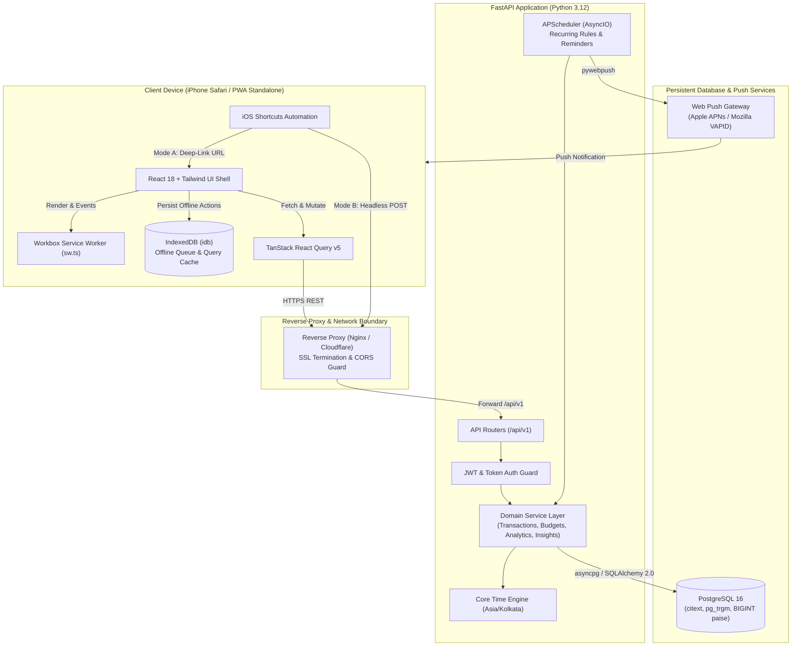
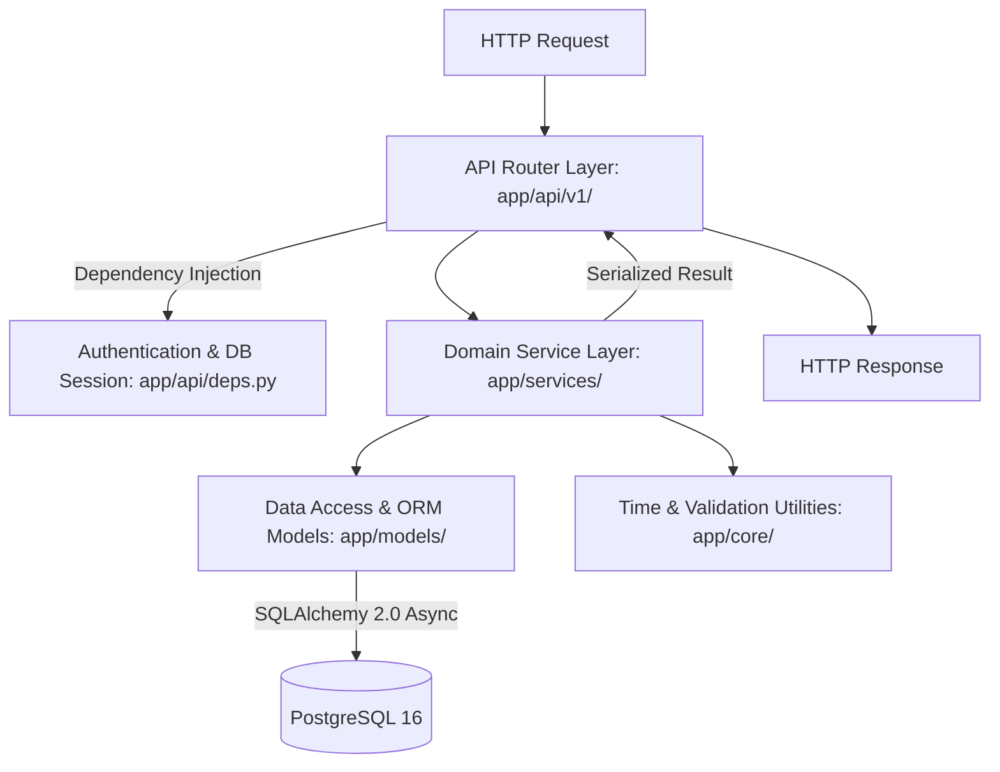
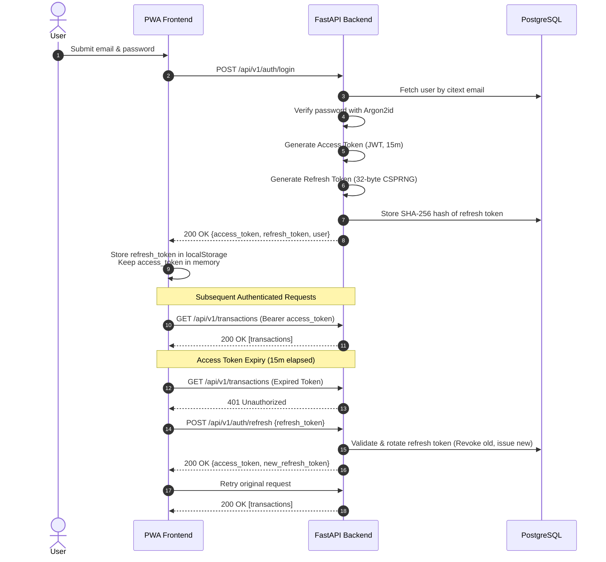
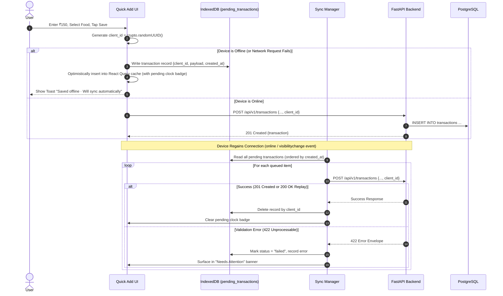

# SpendWise — System Architecture Specification

## 1. Architectural Overview

SpendWise is engineered as a modern, decoupled, mobile-first web architecture optimized for high-velocity personal expense logging and instant financial intelligence. 

The architecture balances three core technical imperatives:
1. **Low-Latency Client Experience:** An installed Progressive Web Application (PWA) operating on iOS Safari that loads from a local service worker cache in under 500 ms, accepts input offline, and communicates via a strictly typed, cursor-paginated REST API.
2. **Deterministic Financial Computation:** An asynchronous Python 3.12 / FastAPI application server backed by PostgreSQL 16, where all monetary arithmetic is performed using integer paise (`BIGINT`), eliminating floating-point rounding errors.
3. **Resilient Data Synchronization:** A local-first client mutation pipeline utilizing IndexedDB (`idb`) and unique client-generated UUIDs (`client_id`) that seamlessly buffers offline actions and replays them idempotently upon network restoration.

---

## 2. High-Level Architecture Diagram



---

## 3. Frontend Architecture

### 3.1 Technology Stack & Core Libraries
- **Framework:** React 18 with TypeScript in strict mode (`"strict": true`).
- **Build Tool:** Vite 5 with `@vitejs/plugin-react` and `vite-plugin-pwa`.
- **Styling:** Tailwind CSS v3 using CSS variables for semantic design tokens and the `class` dark mode strategy.
- **Routing:** `react-router-dom` v6 with protected route wrappers (`AuthGuard`).
- **Server State Management:** `@tanstack/react-query` v5 with `@tanstack/react-query-persist-client`.
- **Local Database:** `idb` (lightweight promise-based IndexedDB wrapper) powering the offline mutation queue.
- **Form Handling:** `react-hook-form` with `zod` for declarative schema validation.
- **Data Visualization:** `recharts` for responsive SVG Donut, Bar, and Area charts.
- **Date & Time:** `date-fns` and `date-fns-tz` for timezone-safe client-side formatting.
- **Iconography:** `lucide-react`.

### 3.2 Modular Feature Architecture
The frontend code is structured around domain-driven feature modules rather than generic technical groupings:

```text
frontend/src/
├── app/                  # App shell, root routing, global providers, bottom TabBar
├── components/           # Reusable UI primitives (Button, Keypad, Sheet, Chip, Toast)
├── lib/                  # Core utilities (api.ts, money.ts, dates.ts, offlineQueue.ts)
├── types/                # TypeScript interfaces and API response contracts
└── features/             # Domain modules
    ├── auth/             # Login, registration, token refresh, password changes
    ├── dashboard/        # Summary cards, spending donut, daily trend, recent activity
    ├── quick-add/        # Custom keypad, category selector, payment selector, prefill
    ├── transactions/     # History list, filter sheet, search, detail/edit bottom sheet
    ├── analytics/        # Overview, category drill-down, temporal trends, heatmap
    ├── budgets/          # Budget cards, progress bars, threshold configuration
    ├── recurring/        # Recurring rules list, due item confirmation cards
    ├── import-export/    # 3-step CSV upload wizard, column mapper, XLSX download
    └── settings/         # Profile, timezone, salary cycle, category manager, API tokens
```

### 3.3 State Management & Data Fetching Lifecycle
1. **Server State (TanStack Query):**
   - React Query acts as the authoritative cache for all remote entities (`transactions`, `categories`, `budgets`, `analytics`).
   - Mutations (e.g., creating an expense) immediately trigger optimistic cache updates and invalidate dependent query keys (`['summary']`, `['analytics']`, `['budgets']`).
   - The query cache is persisted to IndexedDB, enabling instantaneous dashboard rendering during cold starts or offline sessions.
2. **Client State:**
   - React local state (`useState`, `useReducer`) governs volatile UI states (e.g., bottom sheet expansion, active filter selections, custom keypad buffer).

---

## 4. Backend Architecture

### 4.1 Framework & Core Engine
- **Runtime:** Python 3.12 (asynchronous event loop).
- **Web Framework:** FastAPI (ASGI), utilizing standard Pydantic v2 schemas for high-speed serialization and request validation.
- **ORM & Database Driver:** SQLAlchemy 2.0 (Async Engine) paired with `asyncpg`.
- **Database Migrations:** Alembic with version-controlled schema evolution.
- **Background Job Scheduler:** APScheduler (`AsyncIOScheduler`) running in-process for recurring expense automation and scheduled reminder evaluations.
- **Push Notification Engine:** `pywebpush` utilizing elliptic curve VAPID keypairs.

### 4.2 Layered Architecture Pattern
The backend enforces a strict three-tier architecture with unidirectional dependencies:



- **Router Layer (`app/api/v1/`):** Pure HTTP boundary. Inspects query/path parameters, authenticates callers, invokes appropriate service functions, and formats HTTP responses. **Strictly forbidden from executing raw SQL or containing business rules.**
- **Service Layer (`app/services/`):** Autonomous business logic modules (`transactions.py`, `budgets.py`, `analytics.py`, `categorization.py`, `csv_import.py`, `recurring.py`, `reminders.py`). Functions accept standard Python objects or Pydantic schemas, perform domain operations, and maintain financial invariants.
- **Persistence Layer (`app/models/`):** Declarative SQLAlchemy 2.0 models mapped to PostgreSQL tables with explicit constraints, foreign keys, and indexes.

---

## 5. Database Architecture

### 5.1 Storage Engine & Extensions
- **RDBMS:** PostgreSQL 16.
- **Extensions:**
  - `citext`: Case-insensitive text handling for user email addresses.
  - `pg_trgm`: Trigram indexing for fast, fuzzy substring matching across transaction descriptions and merchant names.
  - `uuid-ossp` / `pgcrypto`: Server-side UUID generation (`gen_random_uuid()`).

### 5.2 Financial Invariants & Data Integrity
1. **Paise-Only Storage:** All monetary attributes are defined as `BIGINT NOT NULL CHECK (amount_minor > 0)`. Zero and negative transactions are prohibited at the schema level.
2. **Multi-Tenant User Isolation:** Every entity table (except global system seeds) contains `user_id UUID NOT NULL REFERENCES users(id) ON DELETE CASCADE`.
3. **Idempotency Keys:** The `transactions` table contains `client_id UUID NULL` with a partial unique index: `UNIQUE (user_id, client_id) WHERE client_id IS NOT NULL`.
4. **Soft-Delete Lifecycle:** Transactions utilize a `deleted_at TIMESTAMPTZ NULL` column. All analytical aggregations filter `WHERE deleted_at IS NULL`.

---

## 6. Authentication & Session Architecture

SpendWise implements a dual-token authentication pattern designed to survive iOS PWA sandboxing quirks:



### 6.1 iOS Standalone Session Durability
Because iOS Safari standalone PWAs frequently purge active in-memory session cookies upon cold termination:
- The cryptographically secure refresh token is retained in `localStorage`.
- On cold application launch, the frontend executes a silent background refresh call before protected routes are mounted, displaying a brief branded splash screen during resolution.

---

## 7. Offline Synchronization Architecture

The offline pipeline allows users to log expenses seamlessly even in network-deprived conditions (e.g., underground metro stations, basements):



---

## 8. Service Responsibilities & Domain Boundaries

| Service Name | Source Path | Core Responsibilities |
|---|---|---|
| **TransactionService** | `app/services/transactions.py` | Transaction CRUD, soft delete, restore, idempotency enforcement, merchant normalization, trigram search filtering. |
| **AnalyticsService** | `app/services/analytics.py` | Temporal aggregation, day/week/month bounds, zero-filling missing trend days, category summaries, period comparisons. |
| **BudgetService** | `app/services/budgets.py` | Budget upserts, real-time burn rate calculations, safe daily spend computations, threshold crossing detection. |
| **InsightService** | `app/services/insights.py` | Deterministic heuristic rule evaluation (weekend spikes, category leaps, logging streaks) returning prioritized insights. |
| **CategorizationService**| `app/services/categorization.py`| User pattern matching, learned rule synthesis, frequency-based category suggestion. |
| **ImportService** | `app/services/csv_import.py` | CSV dialect detection, column mapping validation, deduplication hash computation, atomic batch commits. |
| **RecurringService** | `app/services/recurring.py` | Rule schedule calculations, monthly day-clamping, hourly background transaction generation, confirmation/skip processing. |
| **ReminderService** | `app/services/reminders.py` | 15-minute evaluation of user local time, 0-expense daily checks, Web Push dispatching, notification rate-limiting. |

---

## 9. External Integrations & Boundary Interfaces

1. **Web Push Gateway (pywebpush / VAPID):**
   - Transmits standard push packets to Apple Push Notification service (APNs) and Google FCM endpoints.
   - Operates strictly with standard VAPID public/private keypairs.
2. **iOS Shortcuts App:**
   - **Mode A (Deep Link):** Interfaces via URL schemes (`https://<domain>/add?amount=...`). Zero backend dependency.
   - **Mode B (REST API):** Connects to `POST /api/v1/shortcuts/transactions` using Personal API Tokens with prefix `sw_`.
3. **CSV Banking Statements:**
   - Stateless file ingestion supporting standard RFC 4180 CSVs, UTF-8-BOM, and Latin-1 encoded bank exports.

---

## 10. Architectural Constraints & Scalability

- **Single Host Deployment (v1):** The entire application stack (PostgreSQL, FastAPI, Vite static build) runs within a unified Docker Compose topology suitable for single-node VPS deployment (e.g., 2 vCPU, 4GB RAM).
- **Scale Ceiling:** Designed to maintain sub-300 ms analytics response times on datasets of up to 50,000 transactions per user via targeted partial and composite indexes.
- **No Heavy Distributed Dependencies:** In-process `AsyncIOScheduler` replaces Redis/Celery for v1 to minimize operational footprint and maintenance overhead.
