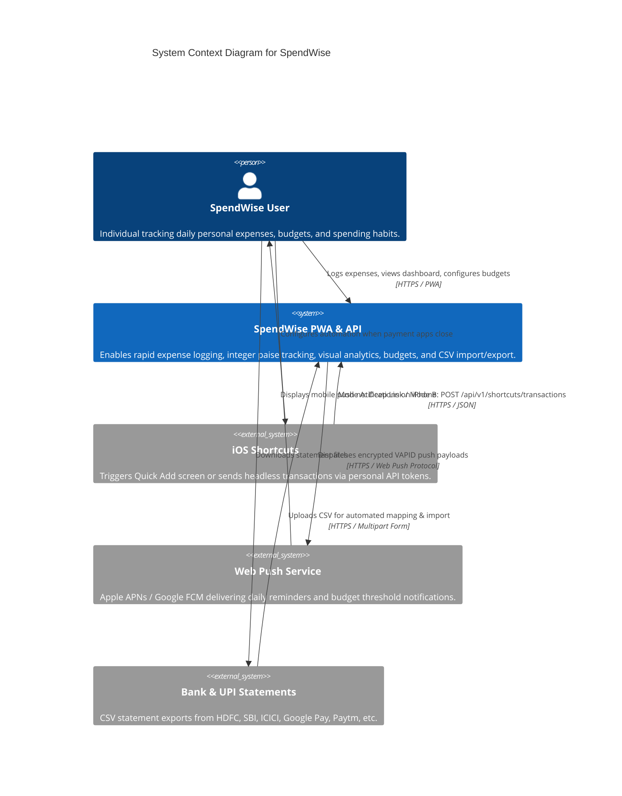
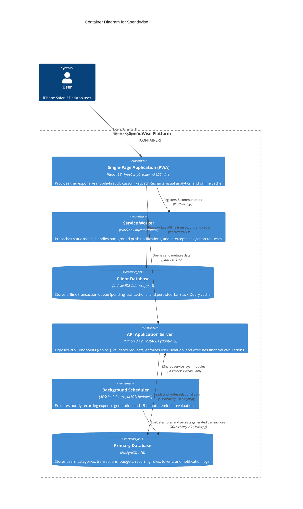
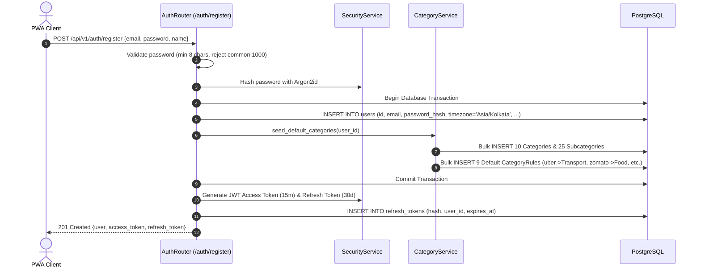
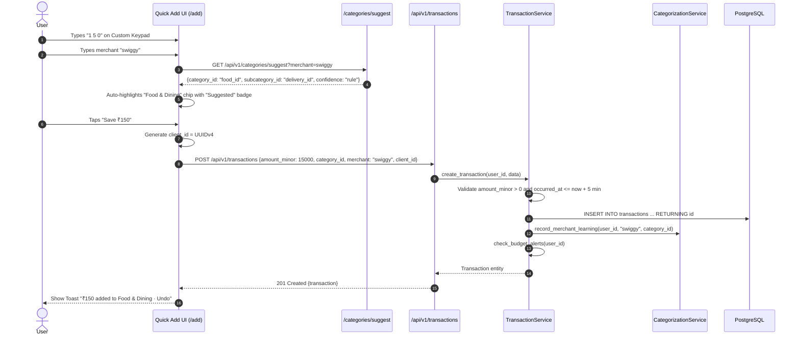
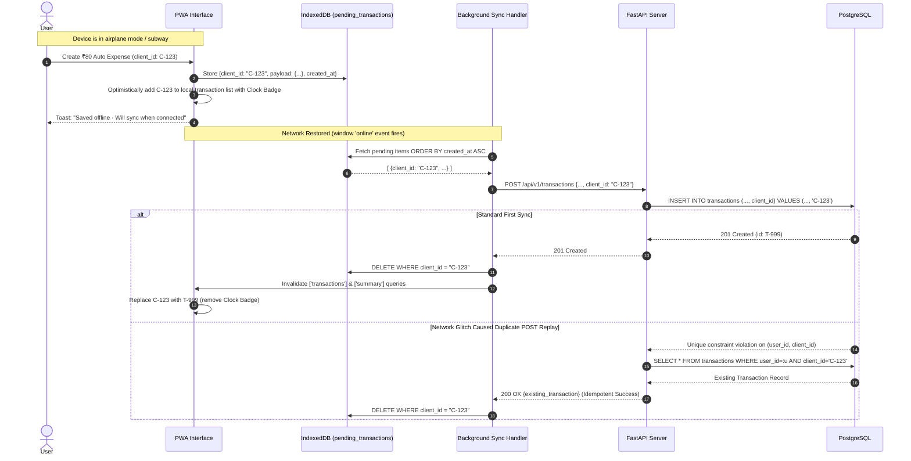
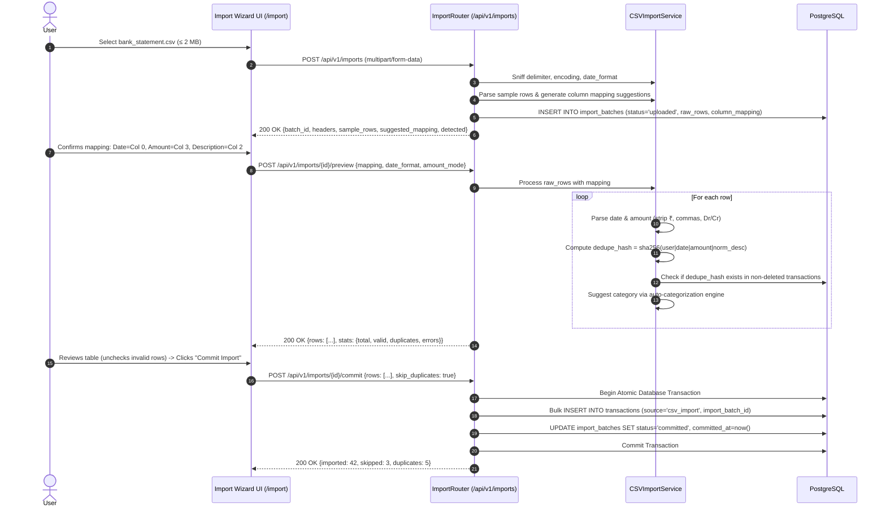
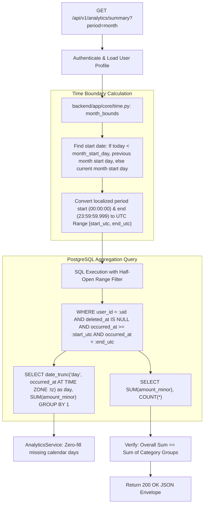
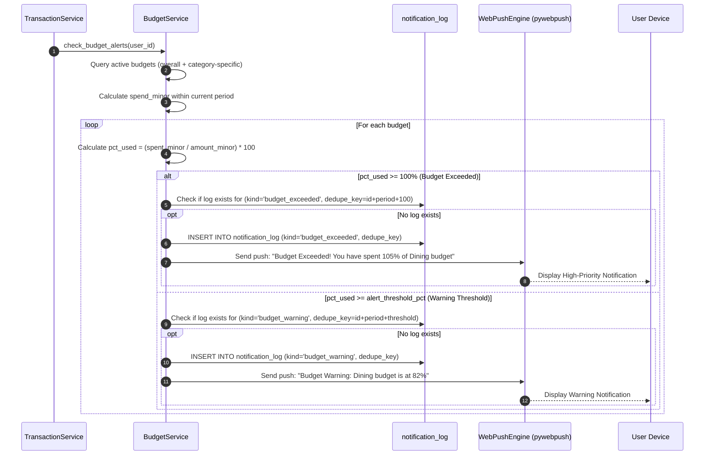
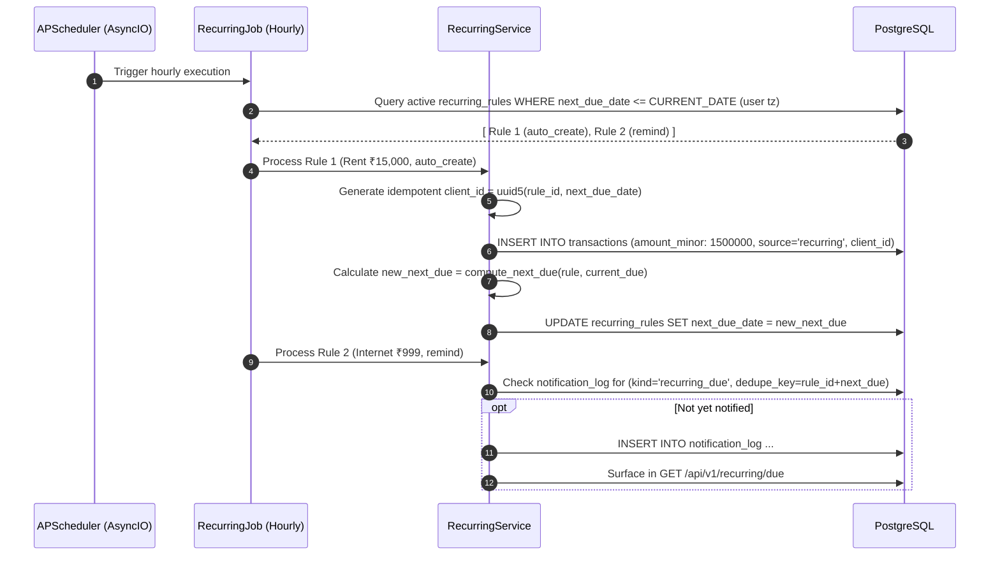

# SpendWise — Detailed System Design & Interaction Models

## 1. System Context Diagram (C4 Level 1)

The system context diagram illustrates SpendWise in relation to its users, external operating platforms, and notification infrastructure:

---

## 2. Container Diagram (C4 Level 2)

---

## 3. Core Interaction & Sequence Diagrams

### 3.1 User Registration & Default Seed Lifecycle
When a new user registers, the system must atomically create the user account and seed default categories along with predefined merchant auto-categorization rules:

---

### 3.2 Quick Expense Creation Flow (Online Path)

---

### 3.3 Offline Expense Synchronization & Conflict Resolution

---

### 3.4 3-Step CSV Statement Import & Deduplication Flow

---

### 3.5 Timezone-Aware Analytics Aggregation Pipeline
All analytical queries must respect the user's localized timezone (`users.timezone`, default `Asia/Kolkata`) and custom salary cycle start day (`users.month_start_day`).

---

### 3.6 Budget Evaluation & Overspend Alert Dispatch

---

### 3.7 Recurring Expense Scheduler & Catch-Up Logic

