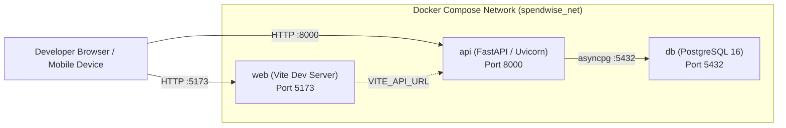
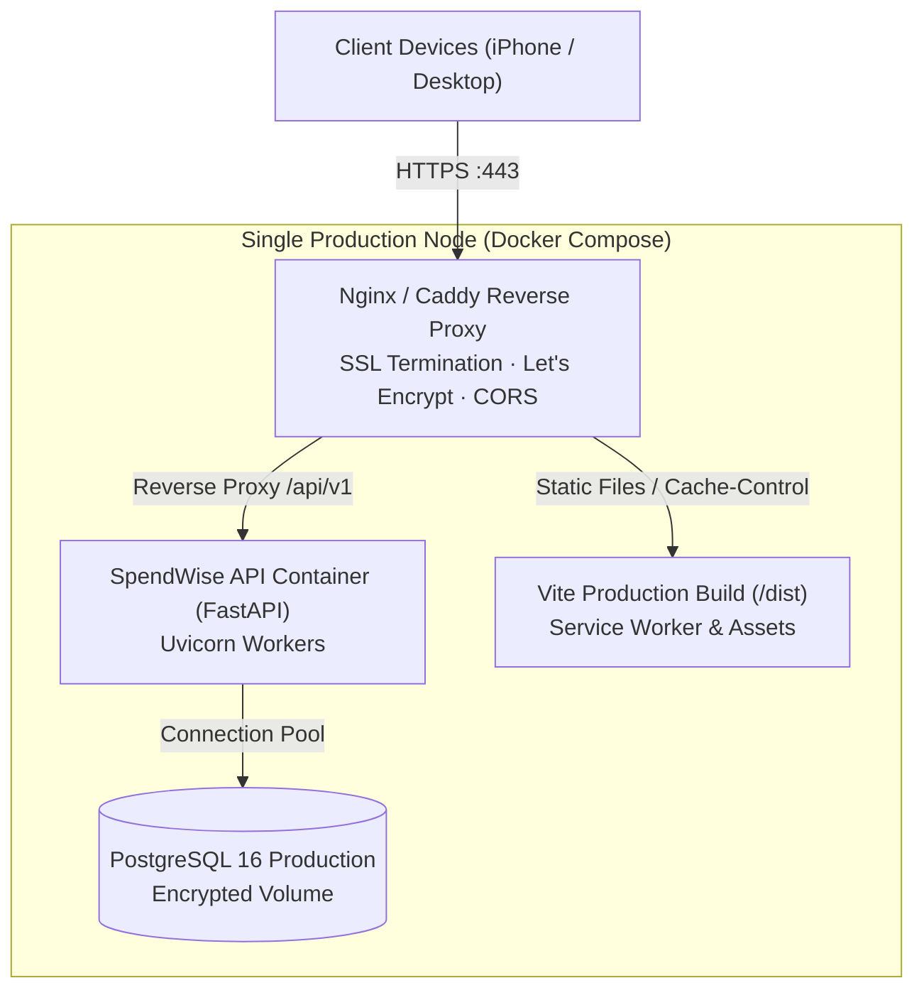
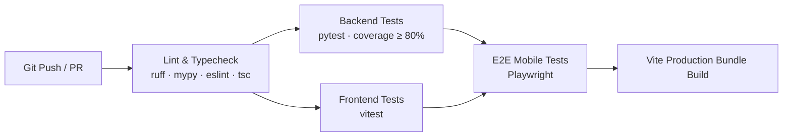

# SpendWise — Deployment & Infrastructure Guide

This document details the deployment workflows, Docker orchestration, production infrastructure specifications, and backup strategies for SpendWise.

---

## 1. Local Development Environment

SpendWise is fully containerized using **Docker Compose** and automated via a root **`Makefile`**.

### 1.1 Prerequisites
- Docker Engine 24.0+ and Docker Compose v2.20+.
- GNU Make.
- Python 3.12 (optional for running commands outside containers).
- Node.js 20+ and npm (optional for running frontend outside containers).

### 1.2 Container Architecture (`docker-compose.yml`)
The development topology consists of three coordinated containers:



1. **`db` (PostgreSQL 16):**
   - Image: `postgres:16-alpine`
   - Volume: `pgdata:/var/lib/postgresql/data`
   - Healthcheck: Executes `pg_isready -U spendwise -d spendwise` every 5 seconds.
2. **`api` (FastAPI Application Server):**
   - Python 3.12 runtime with live code reloading (`uvicorn --reload --host 0.0.0.0 --port 8000`).
   - Automatically executes `alembic upgrade head` on container startup before binding the web server.
   - Depends on `db` being healthy.
3. **`web` (React 18 / Vite Client):**
   - Node 20 runtime running `vite --host 0.0.0.0 --port 5173`.
   - Exposes port 5173 with hot-module replacement (HMR).

### 1.3 Standard Development Commands (`Makefile`)
| Command | Action |
|---|---|
| `make up` | Builds and launches all containers in the background (`docker compose up --build -d`). |
| `make down` | Gracefully terminates and removes all running containers. |
| `make logs` | Streams consolidated logs across `db`, `api`, and `web`. |
| `make migrate` | Executes pending Alembic migrations (`alembic upgrade head`). |
| `make revision m="message"` | Generates a new autogenerated Alembic migration. |
| `make seed-demo` | Seeds demo account (`demo@spendwise.app` / `demo1234`) with 3 months of realistic INR transactions. |
| `make test` | Executes both backend (`pytest`) and frontend (`vitest`) test suites. |
| `make e2e` | Executes Playwright end-to-end tests against the mobile viewport. |
| `make lint` | Runs `ruff check`, `mypy --strict`, `eslint`, and `tsc --noEmit`. |
| `make vapid` | Generates a new VAPID cryptographic keypair for Web Push. |

---

## 2. Testing on Physical iPhone Hardware (Local HTTPS)

> [!IMPORTANT]
> **PWA & Web Push Requirement:** Service Workers and iOS Web Push strictly require an **HTTPS** connection (except on `localhost`). To test Add-to-Home-Screen and push notifications on an iPhone during local development, use an HTTPS reverse tunnel.

### Using Cloudflare Tunnel
1. Install `cloudflared`:
   ```bash
   brew install cloudflared
   ```
2. Start quick tunnels for both services:
   ```bash
   # Terminal 1: Tunnel frontend
   cloudflared tunnel --url http://localhost:5173
   # Terminal 2: Tunnel backend
   cloudflared tunnel --url http://localhost:8000
   ```
3. Update `frontend/.env` with the HTTPS backend tunnel URL (`VITE_API_URL=https://<tunnel-api>.trycloudflare.com/api/v1`).
4. Update `backend/.env` with the HTTPS frontend tunnel URL (`FRONTEND_ORIGIN=https://<tunnel-web>.trycloudflare.com`).
5. Open the frontend tunnel URL on Safari on your iPhone, tap **Share** → **Add to Home Screen**, and launch the PWA.

---

## 3. Production Deployment Architecture

In production, SpendWise can be deployed onto a single hardened Linux Virtual Private Server (VPS) or cloud instance (e.g., Ubuntu 24.04 LTS, 2 vCPU, 4 GB RAM):



### 3.1 Reverse Proxy & SSL Configuration (Caddy Example)
Caddy automatically provisions and renews Let's Encrypt SSL certificates:

```caddyfile
app.spendwise.in {
    root * /var/www/spendwise/dist
    file_server

    # Static assets long-term cache
    @static {
        path /assets/* /icons/*
    }
    header @static Cache-Control "public, max-age=31536000, immutable"

    # Service Worker must NEVER be cached
    @sw {
        path /sw.js /manifest.webmanifest
    }
    header @sw Cache-Control "no-cache, no-store, must-revalidate"

    # Single-Page Application routing fallback
    try_files {path} /index.html
}

api.spendwise.in {
    reverse_proxy localhost:8000 {
        header_up X-Real-IP {remote_host}
        header_up X-Forwarded-Proto {scheme}
    }
}
```

---

## 4. Continuous Integration & Deployment (CI/CD)

The automated pipeline (GitHub Actions / GitLab CI) validates every pull request:



### CI Pipeline Steps:
1. **Linting & Type Analysis:** `make lint` enforces zero warnings.
2. **Backend Services Coverage:** `pytest --cov=app/services --cov-fail-under=80` ensures business logic coverage.
3. **Frontend Tests:** `npm run test` executes component tests.
4. **Build Verification:** `npm run build` confirms production bundle builds within size limits (≤ 250 KB gzipped).
5. **E2E Automation:** Runs Playwright mobile tests in a headless Chromium container.

---

## 5. Health Checks, Monitoring & Observability

### 5.1 Health Check Endpoint
- **URL:** `GET /api/v1/health`
- **Behavior:** Executes a lightweight database ping (`SELECT 1`).
- **Response:**
  - Database healthy: `200 OK {"status": "ok", "db": "ok"}`
  - Database unreachable: `503 Service Unavailable {"status": "degraded", "db": "error"}`

### 5.2 Structured Logging
- Application logs are written in structured JSON to standard output (`stdout`), captured by Docker daemon log drivers:
  ```json
  {"timestamp": "2026-11-02T14:30:00Z", "level": "INFO", "request_id": "req_123", "user_id": "c1f7...", "path": "/api/v1/transactions", "method": "POST", "status": 201, "duration_ms": 14.2}
  ```
- Docker log rotation is configured in `daemon.json` (`max-size: "50m"`, `max-file: "5"`).

---

## 6. Backup & Disaster Recovery

### 6.1 Automated Daily Database Backups
A cron script on the host system triggers an atomic PostgreSQL dump every night at 02:00 IST:

```bash
#!/usr/bin/env bash
set -eo pipefail
BACKUP_DIR="/var/backups/spendwise"
TIMESTAMP=$(date +"%Y%m%d_%H%M%S")
FILENAME="$BACKUP_DIR/spendwise_$TIMESTAMP.sql.gz"

mkdir -p "$BACKUP_DIR"
docker compose exec -T db pg_dump -U spendwise -d spendwise | gzip > "$FILENAME"

# Retain last 30 days of daily backups
find "$BACKUP_DIR" -type f -name "spendwise_*.sql.gz" -mtime +30 -delete
```

### 6.2 Restoration Procedure
```bash
gunzip < /var/backups/spendwise/spendwise_YYYYMMDD_HHMMSS.sql.gz | docker compose exec -T db psql -U spendwise -d spendwise
```
