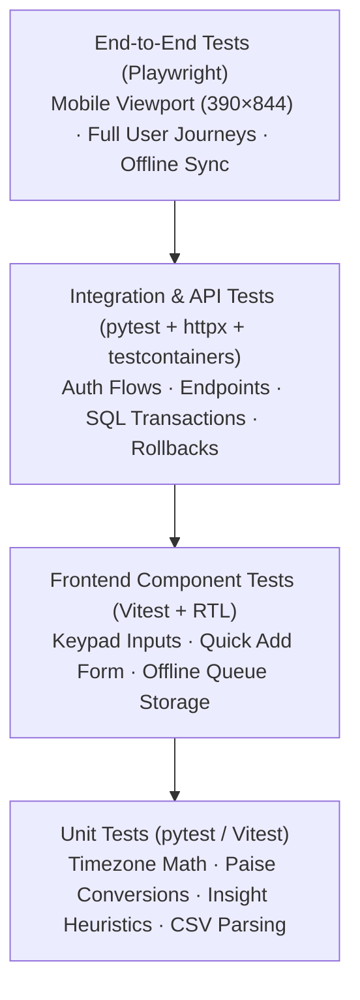

# SpendWise — Comprehensive Testing & Quality Assurance Strategy

## 1. Quality Assurance Philosophy & Definition of Done

SpendWise manages real personal financial records. A single arithmetic error, timezone boundary offset, or cross-user data leakage represents a catastrophic loss of trust. Therefore, testing is treated as a first-class engineering deliverable rather than an afterthought.

### 1.1 Definition of Done (DoD)
A feature or milestone is considered **Done** only when:
1. **Unit & Integration Tests Pass:** 100% of automated tests pass cleanly in local and CI environments.
2. **Coverage Threshold Satisfied:** Backend domain services (`backend/app/services/`) maintain a minimum of **80% line coverage**.
3. **User Isolation Verified:** Automated cross-tenant tests confirm that User A cannot read or mutate User B's resources.
4. **Zero Static Analysis Errors:** `ruff check`, `mypy --strict`, `eslint`, and `tsc --noEmit` pass with zero warnings or errors.
5. **No Floating-Point Money Calculations:** Automated grep test verifies no `float` usages exist within monetary code paths.
6. **Mobile E2E Scenario Passes:** Playwright E2E test runs successfully against the iPhone mobile viewport.

---

## 2. Testing Pyramid & Tooling Inventory



| Layer | Primary Framework | Target Files | Key Responsibilities |
|---|---|---|---|
| **Backend Unit & Integration** | `pytest`, `pytest-asyncio`, `httpx` | `backend/tests/` | Service logic, SQL queries, boundary calculations, API contracts. |
| **Test Database** | `testcontainers` (PostgreSQL 16) | Docker engine | Spin up ephemeral PostgreSQL containers for clean test isolation. |
| **Frontend Unit & Component**| `vitest`, `@testing-library/react` | `frontend/src/**/*.test.tsx` | Money formatting, custom numeric keypad, offline queue, form validation. |
| **End-to-End (E2E)** | `playwright` | `e2e/` | Mobile viewport workflows: register → quick add → offline test → sync. |

---

## 3. Backend Test Suite Specifications

### 3.1 Timezone & Temporal Boundary Tests (`tests/test_time.py`)
- **IST Non-DST Consistency:** Verify `day_bounds`, `week_bounds`, and `month_bounds` calculate exact UTC ranges for `Asia/Kolkata` (UTC+05:30) with zero drift.
- **Configurable Salary Month Start (`month_start_day ≠ 1`):**
  - Given `month_start_day = 25` and current date `10 Nov 2026`: Verify month range spans `2026-10-25 00:00:00+05:30` to `2026-11-25 00:00:00+05:30`.
- **Leap Year & 31-Day Clamping:**
  - Verify that a monthly recurring rule scheduled on the 31st evaluates to Feb 28 in standard years and Feb 29 in leap years.
- **Half-Open Intervals:** Verify all queries utilize `[start_inclusive, end_exclusive)` so that a transaction at exactly `00:00:00` on the 1st of the next month is never counted twice.

### 3.2 Financial Arithmetic & Grep Guard (`tests/test_money.py`)
- **Zero Float Grep Test:** Automated test that scans all Python files in `backend/app/services/` and asserts that no `float()` calls or float literals exist in monetary calculation paths.
- **Paise Precision Table Tests:**
  - `"₹1,250.50"` parses to `125050`.
  - `"1250.5 Dr"` parses to `125050`.
  - `"(250)"` parses to `25000` (standard accounting negative notation).
  - `"Rs. 40"` parses to `4000`.

### 3.3 Strict Multi-Tenant User Isolation (`tests/test_isolation.py`)
Parametrized test suite executing across all resources (Transactions, Categories, Budgets, API Tokens, Recurring Rules):
```python
@pytest.mark.asyncio
@pytest.mark.parametrize("endpoint,method", [
    ("/api/v1/transactions/{id}", "GET"),
    ("/api/v1/transactions/{id}", "PATCH"),
    ("/api/v1/transactions/{id}", "DELETE"),
    ("/api/v1/categories/{id}", "PATCH"),
    ("/api/v1/categories/{id}", "DELETE"),
    ("/api/v1/budgets/{id}", "DELETE"),
])
async def test_cross_tenant_access_forbidden(client_user_a, user_b_resources, endpoint, method):
    url = endpoint.format(id=user_b_resources["id"])
    response = await client_user_a.request(method, url)
    assert response.status_code in (404, 403), f"Cross-tenant leak detected on {method} {url}"
```

### 3.4 Authentication & Token Rotation Tests (`tests/test_auth.py`)
1. **Password Rejection:** Assert that passwords shorter than 8 characters or matching common passwords (e.g., `password123`) fail registration with `422`.
2. **Refresh Token Rotation:** Assert that calling `/auth/refresh` revokes the submitted refresh token and returns a new valid pair.
3. **Reuse Detection (Token Theft):** Assert that submitting an already revoked refresh token triggers immediate revocation of all active sessions for that user.

### 3.5 CSV Statement Import & Rollback (`tests/test_csv_import.py`)
1. **Dialect Sniffing:** Verify automatic detection of commas, semicolons, tabs, and diverse date formats (`DD/MM/YYYY`, `YYYY-MM-DD`, `DD MMM YYYY`).
2. **Duplicate Detection:** Confirm that transactions sharing the same `dedupe_hash` are flagged as duplicates during preview.
3. **Atomic Commit & Rollback:** Test that a database constraint violation mid-batch rolls back the entire transaction batch, leaving zero orphaned records.
4. **Import Undo:** Verify that `DELETE /api/v1/imports/{id}` soft-deletes all transactions associated with that batch.

---

## 4. Frontend Unit & Component Tests

### 4.1 Custom Numeric Keypad (`src/components/Keypad.test.tsx`)
- Verify tapping numeric keys appends digits.
- Verify decimal point button `.` allows at most 2 decimal places (e.g., prevents `150.555`).
- Verify backspace `⌫` removes the last digit.
- Verify long-press on backspace clears the entire amount.

### 4.2 Offline Queue Management (`src/lib/offlineQueue.test.ts`)
- Verify that when network is disconnected, `enqueueTransaction` writes to IndexedDB with a unique `client_id`.
- Verify that `replayQueue` dispatches transactions in sequential chronological order.
- Verify that a `200 OK` or `201 Created` response removes the item from the queue, while a `422 Unprocessable Entity` marks the item as failed.

---

## 5. End-to-End (E2E) Test Suite (Playwright)

Configured in `e2e/playwright.config.ts` using the **iPhone 14 / Safari** mobile viewport (390 × 844 px, touch enabled, device pixel ratio 3).

### 5.1 Critical Path Mobile User Journey
```typescript
test('Complete Mobile Expense Logging & Offline Sync Journey', async ({ page, context }) => {
  // 1. Register new user
  await page.goto('/register');
  await page.fill('input[name="email"]', 'e2e_user@spendwise.in');
  await page.fill('input[name="password"]', 'StrongPass123!');
  await page.click('button:has-text("Sign Up")');

  // 2. Open Quick Add
  await page.click('button[aria-label="Add expense"]');
  await expect(page).toHaveURL('/add');

  // 3. Enter amount using custom keypad
  await page.click('button:has-text("1")');
  await page.click('button:has-text("5")');
  await page.click('button:has-text("0")');
  await expect(page.locator('[data-testid="amount-display"]')).toHaveText('₹150');

  // 4. Select top category chip
  await page.click('button:has-text("Food & Dining")');
  await page.click('button:has-text("Save ₹150")');

  // 5. Verify Toast and Dashboard update
  await expect(page.locator('.toast')).toContainText('₹150 added to Food & Dining');
  await expect(page.locator('[data-testid="today-total"]')).toHaveText('₹150');

  // 6. Test Offline Logging
  await context.setOffline(true);
  await page.click('button[aria-label="Add expense"]');
  await page.click('button:has-text("8")');
  await page.click('button:has-text("0")');
  await page.click('button:has-text("Transportation")');
  await page.click('button:has-text("Save ₹80")');

  // Verify offline banner and pending badge
  await expect(page.locator('.toast')).toContainText('Saved offline');
  await expect(page.locator('[data-testid="pending-badge"]')).toBeVisible();

  // 7. Reconnect and verify idempotent sync
  await context.setOffline(false);
  await page.waitForTimeout(1000); // Wait for online event sync
  await expect(page.locator('[data-testid="pending-badge"]')).not.toBeVisible();
  await expect(page.locator('[data-testid="today-total"]')).toHaveText('₹230');
});
```

---

## 6. Performance & Benchmark Targets

- **Dashboard First Contentful Paint:** < 1.5 seconds on mobile 4G network profile; < 0.5s for cached PWA shell.
- **Analytics Query Scalability:** p95 latency < 300 ms across a seeded dataset of **50,000 transactions** for a single user (benchmarked via `python -m app.seed.demo_data --count 50000`).
- **Initial Frontend Bundle Size:** ≤ 250 KB gzipped JavaScript (monitored via `vite-bundle-visualizer`).
