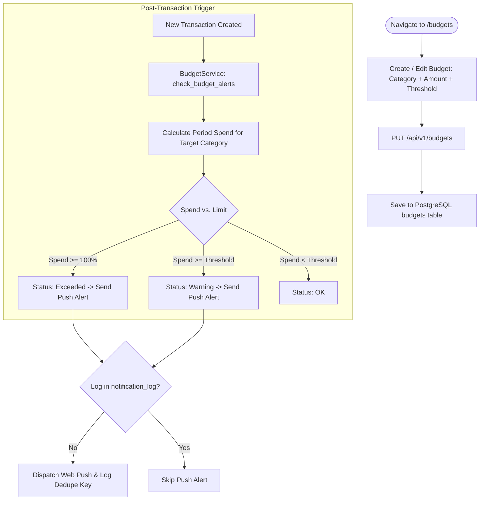

# SpendWise — Feature Specification: Budget Management

## 1. Overview & Business Objective

Budget Management empowers users to transition from passive expense recording to proactive financial self-discipline. Users set overall monthly expenditure ceilings and category-specific allowances, receiving real-time progress indicators and proactive warnings before overspending occurs.

---

## 2. User Stories

- **US-BUD-01:** As a user trying to save money, I want to set a total monthly spending limit (e.g., ₹25,000) so that I know how much disposable income I have left.
- **US-BUD-02:** As a user prone to overspending on food delivery, I want to set a dedicated budget for "Food & Dining" (e.g., ₹6,000).
- **US-BUD-03:** As a user planning my month, I want to see my "Safe Daily Spend" (remaining budget divided by remaining days) so that I can adjust my daily spending pace.
- **US-BUD-04:** As an active mobile user, I want to receive a push notification when I reach 80% and 100% of my budget so that I can curb unnecessary purchases.

---

## 3. User Flow & Alert Trigger Lifecycle

---

## 4. Functional Requirements & Business Logic

### 4.1 Budget Scoping & Periods
- **Overall Budget:** Configured with `category_id = NULL`. Evaluates the sum of all transactions across all categories within the active period.
- **Category Budgets:** Configured with a non-null `category_id`. Evaluates transactions belonging to that top-level category **and all of its child subcategories**.
- **Periods:** Default is `monthly`, aligned with the user's configured `month_start_day`.

### 4.2 Status Calculation Rules
For any budget entity with limit `amount_minor` and current period spend `spent_minor`:
- `pct_used = (spent_minor / amount_minor) * 100`
- `remaining_minor = max(amount_minor - spent_minor, 0)`
- **Status Enum:**
  - `exceeded`: `spent_minor >= amount_minor` (Red UI / Destructive).
  - `warning`: `pct_used >= alert_threshold_pct` and `pct_used < 100` (Amber UI / Warning).
  - `ok`: `pct_used < alert_threshold_pct` (Green UI / Primary).

### 4.3 Safe Daily Spend Computation
To provide actionable pacing advice:
$$\text{safe\_daily\_minor} = \frac{\max(\text{remaining\_minor}, 0)}{\text{days\_left}}$$
Where `days_left` is the number of remaining days in the active month (inclusive of today).

### 4.4 Mid-Period Budget Creation
If a user creates or updates a budget mid-month, the system calculates current period expenditure retroactively from the period start date, providing immediate and accurate progress metrics.

---

## 5. Data & API Dependencies

- **Database Entities:** [DATABASE.md](../technical/DATABASE.md) — `budgets`, `transactions`, `notification_log`.
- **API Endpoints:** [API_SPEC.md](../technical/API_SPEC.md) —
  - `GET /api/v1/budgets`
  - `PUT /api/v1/budgets`
  - `DELETE /api/v1/budgets/{id}`

---

## 6. Notification Deduplication Architecture

To avoid spamming users when multiple small transactions occur around threshold boundaries:
- The `notification_log` table maintains a composite unique constraint: `UNIQUE (user_id, kind, dedupe_key)`.
- **Dedupe Key Construction:** `budget_id + ":" + period_start_date + ":" + level` (where level is `"warning"` or `"exceeded"`).
- A notification is transmitted via Web Push **only once per budget per period per severity level**.

---

## 7. Testing Scenarios & Acceptance Criteria

1. **Threshold Crossing Test:** Create a ₹1,000 budget with 80% threshold. Log ₹750 expense (Status: OK). Log ₹100 expense (Total ₹850, Status: Warning, Push dispatched). Log ₹200 expense (Total ₹1,050, Status: Exceeded, Push dispatched).
2. **Deduplication Test:** Verify that adding another ₹50 expense after crossing 100% does not send a duplicate push notification.
3. **Mid-Period Recalculation:** Seed ₹5,000 of expenses on day 10; create an overall budget of ₹10,000 on day 15; verify the budget immediately displays 50% used.
