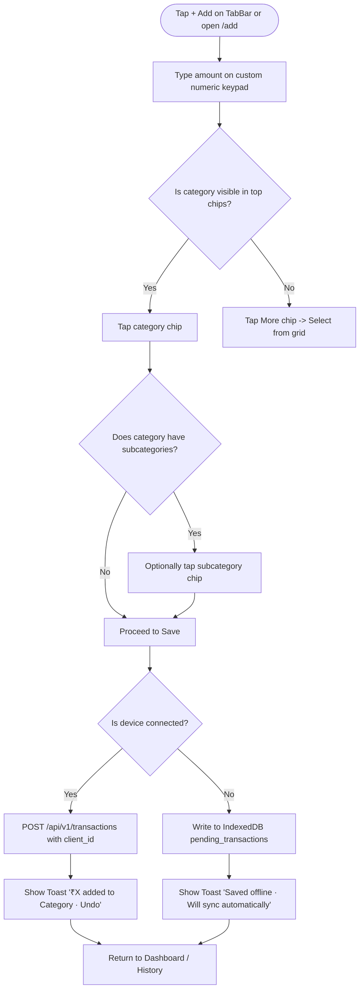

# SpendWise — Feature Specification: Expense Management

## 1. Overview & Business Objective

Expense Management is the foundational core of SpendWise. Its objective is to allow individuals to record everyday personal expenses in **5–10 seconds** and within **≤ 3 taps** after typing the amount, while maintaining strict financial precision and offline survivability.

---

## 2. User Stories

- **US-EXP-01:** As a user making frequent digital UPI payments, I want to record an expense immediately after leaving a payment app so that I do not forget where my money went.
- **US-EXP-02:** As a user in a hurry, I want my most frequently used categories displayed prominently so that I don't have to scroll through dozens of options.
- **US-EXP-03:** As a user in an underground subway or parking lot, I want to save an expense offline without seeing an error message.
- **US-EXP-04:** As a user who made a mistake, I want to quickly tap "Undo" on the confirmation toast to delete an accidental entry without navigating away.
- **US-EXP-05:** As a user reviewing past spending, I want to search and filter transactions by merchant, description, category, and date range.

---

## 3. User Flow

---

## 4. Functional Requirements & Business Logic

1. **Amount Input Constraints:**
   - Handled via custom in-app 3×4 numeric keypad.
   - Values are captured in rupees and converted to integer paise (`amount_minor = round(val * 100)`).
   - Maximum amount allowed: `₹1,00,00,000` (10 crore = `1_000_000_000` paise). Minimum: `₹0.01` (`1` paisa).
   - Maximum 2 decimal places allowed.
2. **Category Selection:**
   - The top 5 categories are dynamically sorted by their rolling 30-day usage count (`categories.usage_count_30d`).
   - If a merchant is entered, the frontend calls `GET /categories/suggest?merchant=...` (debounced 250ms). If a suggestion is returned and the user has not manually picked a category, the suggested chip is pre-highlighted.
3. **Subcategories:**
   - Selecting a parent category reveals child chips. Selecting a subcategory is **optional** and never blocks the Save button.
4. **Idempotency & Offline Handling:**
   - Every creation request generates a client-side UUID (`client_id = crypto.randomUUID()`).
   - The database enforces `UNIQUE (user_id, client_id) WHERE client_id IS NOT NULL`.
   - Repeated requests with identical `client_id` return `200 OK` with the existing transaction.
5. **Soft-Delete & Restore Lifecycle:**
   - Deleting sets `deleted_at = now()`.
   - The Undo toast calls `POST /transactions/{id}/restore`, setting `deleted_at = null`.

---

## 5. Data & API Dependencies

- **Database Entities:** [DATABASE.md](../technical/DATABASE.md) — `transactions`, `categories`, `category_rules`.
- **API Endpoints:** [API_SPEC.md](../technical/API_SPEC.md) —
  - `POST /api/v1/transactions`
  - `GET /api/v1/transactions`
  - `GET /api/v1/transactions/{id}`
  - `PATCH /api/v1/transactions/{id}`
  - `DELETE /api/v1/transactions/{id}`
  - `POST /api/v1/transactions/{id}/restore`
  - `GET /api/v1/categories/suggest`

---

## 6. UI/UX Specifications

- Refer to [UI_UX_SPEC.md](../design/UI_UX_SPEC.md) Screen 4 (Quick Add) and Screen 5 (Transaction History).
- The Quick Add screen must fit within 844 px height without vertical scrolling.
- Swipe left on transaction rows in History reveals the delete button.

---

## 7. Error Cases & Edge Cases

| Condition | System Action | User Feedback |
|---|---|---|
| Amount typed is 0 | Save button remains disabled. | Visual disabled state on button. |
| Timestamp is > now + 5 min | Backend rejects with `422`. | Inline error: "Transaction date cannot be in the future." |
| Network drops during save | Intercepted by offline queue handler. | Toast: "Saved offline. Will sync when back online." |
| Subcategory does not belong to parent | Backend rejects with `422`. | Inline error: "Invalid subcategory selection." |

---

## 8. Security & User Isolation

- Every transaction query and mutation filters strictly by `user_id == current_user.id`.
- Attempting to access or delete another user's transaction returns `404 Not Found`.

---

## 9. Testing Scenarios & Acceptance Criteria

1. **≤ 3 Taps Criterion:** Verify that after typing digits on the keypad, a user can tap a category chip and tap Save to successfully log an expense.
2. **Undo Test:** Save a transaction, immediately tap "Undo" on the toast, and verify the transaction is marked soft-deleted and disappears from Dashboard totals.
3. **Idempotent Sync:** Simulate network retry with identical `client_id` and confirm no duplicate rows are created in PostgreSQL.
4. **Trigram Search:** Create transaction with merchant "Saravana Bhavan"; search for "sarav" and verify it matches.
