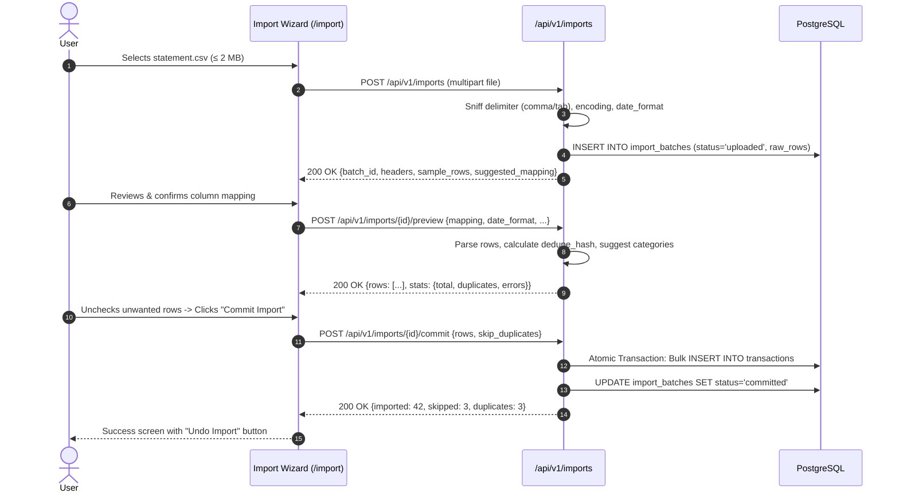

# SpendWise — Feature Specification: Statement Import & Export

## 1. Overview & Business Objective

Statement Import & Export solves the historical data onboarding problem and provides complete personal data portability. Users can upload CSV statements from banks (HDFC, SBI, ICICI) and payment apps (Google Pay, Paytm), preview and reconcile transactions with automated duplicate detection, and export their financial history into clean CSV or multi-sheet Excel workbooks.

---

## 2. User Stories

- **US-IMP-01:** As a new user migrating from bank statements or another tracker, I want to upload a CSV file so that I can analyze my past 3 months of spending immediately without manual entry.
- **US-IMP-02:** As a user importing a bank statement, I want SpendWise to auto-detect the column mapping and date formats so that I don't have to reformat the file in Excel first.
- **US-IMP-03:** As a user importing statements monthly, I want duplicate transactions flagged automatically so that overlapping statements don't double-count expenses.
- **US-IMP-04:** As a user who accidentally uploaded the wrong file, I want to click "Undo Import" to delete all transactions created from that batch in one click.
- **US-IMP-05:** As a user preparing my taxes or sharing expenses with an accountant, I want to export my transactions into a formatted Excel workbook with summary sheets.

---

## 3. CSV Import Wizard Flow

---

## 4. Functional Requirements & Business Logic

### 4.1 Ingestion & Dialect Detection
- **File Limits:** Maximum size = **2 MB**; Maximum rows = **5,000**.
- **Auto-Detection Capabilities:**
  - Delimiters: Comma (`,`), Semicolon (`;`), Tab (`\t`), Pipe (`|`).
  - Encodings: `utf-8`, `utf-8-sig` (with BOM), `latin-1`.
  - Date Formats: `DD/MM/YYYY`, `DD-MM-YYYY`, `YYYY-MM-DD`, `DD MMM YYYY`, `DD/MM/YY`.

### 4.2 Amount & Debit Handling
- SpendWise is an **expense tracker**. Credit (deposit/income) rows are skipped by default (`skip_credits = true`).
- Supports both:
  - **Debit/Credit Split Columns:** E.g., HDFC/SBI statements with distinct Withdrawal and Deposit columns.
  - **Single Signed Columns:** Negative numbers or suffixes (`Dr` vs `Cr`, `(250)` vs `250`).
- Text sanitization automatically strips currency symbols (`₹`, `Rs.`, `INR`) and thousands separators (`,`).

### 4.3 Deduplication Engine
For each parsed row, the backend computes a cryptographic deduplication hash:
$$\text{dedupe\_hash} = \text{sha256}(\text{user\_id} + "|" + \text{local\_date} + "|" + \text{amount\_minor} + "|" + \text{normalize}(\text{description}))$$
Where `normalize()` lowercases text, collapses whitespace, and strips punctuation.
- A row is marked as a **Duplicate** if its hash matches an active, non-deleted transaction in the database.
- Multiple identical purchases in the same file (e.g., two ₹40 teas on the same afternoon) are flagged as *informational* warnings rather than hard errors.

### 4.4 Atomic Commit & Undo
- Committing a batch executes within a single database transaction. If any row insertion fails, the entire batch rolls back.
- **Undo Import (`DELETE /api/v1/imports/{id}`):** Soft-deletes every transaction associated with `import_batch_id`, cleanly reversing the import without leaving orphan records.

---

## 5. Export Specifications (CSV & Excel)

### 5.1 Clean CSV Export (`GET /exports/transactions.csv`)
- Respects all active filter parameters (date range, categories, payment methods).
- Encoded as UTF-8 with Byte Order Mark (`\uFEFF`) for seamless opening in Microsoft Excel on Mac and Windows.
- **Formula Injection Defense:** Any text cell starting with `=`, `+`, `-`, or `@` is prefixed with a single quote (`'`).

### 5.2 Multi-Sheet Excel Workbook (`GET /exports/transactions.xlsx`)
Generated using Python `openpyxl`:
1. **Sheet 1 ("Transactions"):** Full ledger with frozen bold headers and currency-formatted amounts (`₹#,##,##0.00`).
2. **Sheet 2 ("Category Summary"):** Total spend and transaction count grouped by top-level category.
3. **Sheet 3 ("Monthly Summary"):** Month-by-month spend totals across the exported date range.

---

## 6. Data & API Dependencies

- **Database Entities:** [DATABASE.md](../technical/DATABASE.md) — `import_batches`, `transactions`.
- **API Endpoints:** [API_SPEC.md](../technical/API_SPEC.md) —
  - `POST /api/v1/imports`
  - `POST /api/v1/imports/{id}/preview`
  - `POST /api/v1/imports/{id}/commit`
  - `GET /api/v1/imports`
  - `DELETE /api/v1/imports/{id}`
  - `GET /api/v1/exports/transactions.csv`
  - `GET /api/v1/exports/transactions.xlsx`

---

## 7. Testing Scenarios & Acceptance Criteria

1. **Dialect Detection Test:** Feed HDFC (`DD/MM/YYYY`) and SBI (`DD MMM YYYY`) CSV samples; verify automatic format detection.
2. **Duplicate Detection Test:** Import a CSV with 10 rows. Re-upload the same file; verify preview flags all 10 rows as duplicates.
3. **Formula Injection Test:** Export a transaction with description `=cmd|' /C calc'!A0`; verify output CSV contains `'=cmd|' /C calc'!A0`.
4. **Undo Rollback Test:** Commit an import of 25 transactions; invoke `DELETE /imports/{id}`; assert all 25 transactions have non-null `deleted_at`.
