# SpendWise — Feature Specification: Apple iOS Shortcuts Integration

## 1. Overview & Business Objective

iOS Shortcuts integration provides seamless friction reduction for iPhone users completing everyday UPI payments. While iOS sandboxing prevents any web app from automatically intercepting transactions from Google Pay, PhonePe, or Paytm, SpendWise bridges this gap through supported Apple Shortcuts automations and restricted API endpoints.

---

## 2. User Stories

- **US-SHO-01:** As an iPhone user, I want an automation that opens SpendWise immediately when I close Google Pay so that I am prompted to log the expense without remembering to open the app.
- **US-SHO-02:** As an advanced iOS user, I want a Siri Shortcut that asks for an amount and category, then logs the expense headlessly in the background via an API token.
- **US-SHO-03:** As a privacy-conscious user, I want to create restricted personal API tokens that can only log transactions and cannot read my financial history.

---

## 3. Integration Modes & Workflows

```mermaid
flowchart TD
    subgraph ModeA ["Mode A: Personal Automation (URL Deep Link)"]
        GPay[User closes Google Pay / PhonePe / Paytm] --> Automation[iOS Automation: Open URL]
        Automation --> URL["https://app.spendwise.in/add?source=shortcut&amount=..."]
        URL --> QuickAdd[Launches Quick Add Screen with Keypad Focused]
    end

    subgraph ModeB ["Mode B: Headless Direct API Logging"]
        Siri[Trigger Shortcut via Siri or Widget] --> Input[Shortcut prompts: Enter Amount & Category]
        Input --> POST["POST /api/v1/shortcuts/transactions\nAuthorization: Bearer sw_..."]
        POST --> APIBackend[SpendWise API: Create Transaction]
        APIBackend --> Response["Return JSON: {id, message: '₹150 added to Food & Dining'}"]
        Response --> Notification[iOS Native Banner: '₹150 added to Food & Dining']
    end
```



---

## 4. Functional Requirements & Business Logic

### 4.1 Mode A: URL Deep Link & Prefill Parameters
- **URL Schema:** `https://app.spendwise.in/add?source=shortcut`
- **Supported Query Parameters:**
  - `amount`: Number or decimal string (e.g., `150.50`).
  - `category`: Category name string (case-insensitive, e.g., `Food%20%26%20Dining` or `Transport`).
  - `merchant`: Merchant name string (e.g., `Blinkit`).
  - `pm`: Payment method string (`upi`, `cash`, `card`, `bank_transfer`).
- **Client Sanitization:**
  - If `amount` is invalid or out of bounds, it is ignored and the keypad remains at `0`.
  - If `category` does not match any user category, it is ignored.
  - Valid parameters populate the Quick Add state immediately and focus the next missing field.

### 4.2 Mode B: Headless Endpoint (`POST /shortcuts/transactions`)
- **Authentication:** Scoped Personal API Token (`sw_...`) or standard JWT access token.
- **Payload:**
```json
{
  "amount": "150",
  "category": "Food & Dining",
  "merchant": "Saravana Bhavan",
  "payment_method": "upi",
  "note": "Breakfast"
}
```
- **Category Resolution Logic:**
  1. Matches provided `category` string against active user categories (case-insensitive).
  2. If omitted or not matched, passes `merchant` to the auto-categorization engine.
  3. If still unresolved, defaults to the **"Others"** category.
- **Response Format:** Returns a concise confirmation message tailored for iOS native banner display:
```json
{
  "id": "550e8400-e29b-41d4-a716-446655440000",
  "message": "₹150 added to Food & Dining"
}
```

### 4.3 API Token Management (`/settings/shortcuts`)
- Users can create named tokens (e.g., *"iPhone 17 Pro Shortcut"*).
- Tokens are displayed **once upon creation** in a modal with an immediate "Copy Token" button.
- Database retains only a **SHA-256 hash** (`token_hash`) and the `last4` characters.
- Scopes are hardcoded to `['transactions:create']`.
- Revoking a token immediately invalidates its use.

---

## 5. Security & Rate Limiting

- **Rate Limit:** Endpoint `POST /shortcuts/transactions` enforces a dedicated rate limit of **30 requests per minute** per API token.
- **Data Protection:** Scoped tokens cannot query transactions, download reports, view balances, or modify categories.

---

## 6. Testing Scenarios & Acceptance Criteria

1. **Mode A Prefill Test:** Navigate to `/add?amount=250&category=Transportation&pm=upi`; verify the keypad shows `₹250`, `Transportation` chip is highlighted, and payment method is `UPI`.
2. **Mode B Execution Test:** Issue a POST request to `/shortcuts/transactions` with a valid `sw_` token; verify transaction is created with `source = 'shortcut'` and response message is `"₹150 added to Food & Dining"`.
3. **Revocation Test:** Revoke the token via `DELETE /api-tokens/{id}`; reissue the request; verify response is `401 Unauthorized`.
