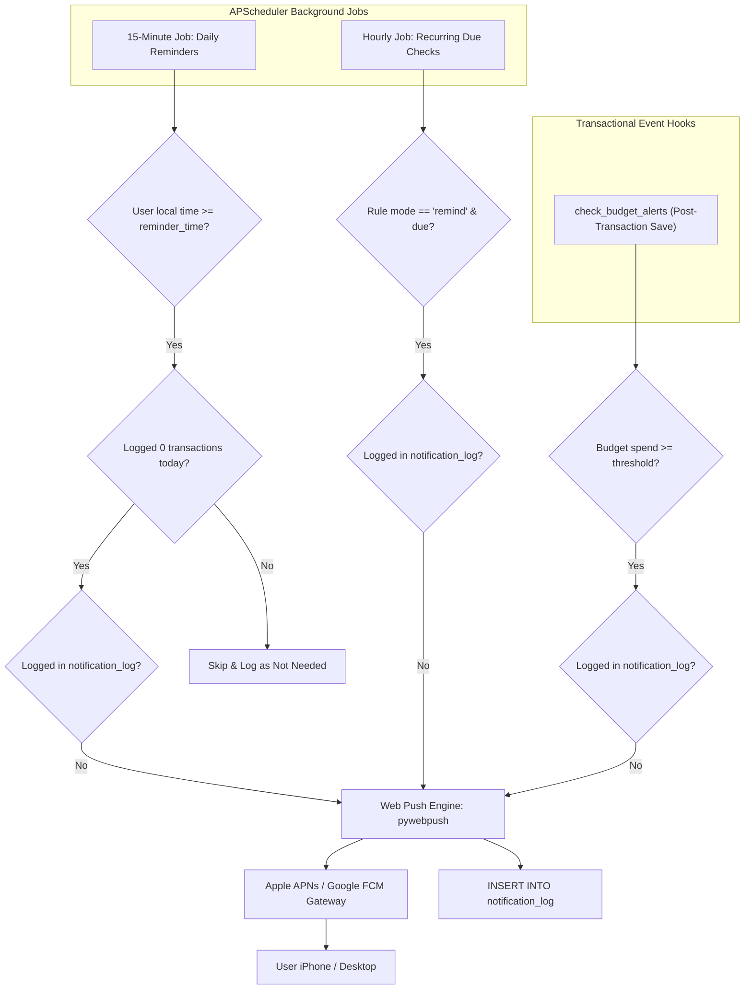

# SpendWise — Feature Specification: Notifications & Reminders

## 1. Overview & Business Objective

Notifications maintain consistent expense tracking habits and provide proactive financial guardrails. SpendWise delivers targeted alerts via standard Web Push (VAPID) directly to installed mobile PWAs and desktop browsers, backed by in-app notification banners.

---

## 2. User Stories

- **US-NOT-01:** As a busy individual, I want a gentle daily reminder at 9:00 PM if I haven't logged any expenses today, so that I maintain an accurate record before going to sleep.
- **US-NOT-02:** As a user who already logged expenses today, I do NOT want to receive a daily reminder, preventing notification fatigue.
- **US-NOT-03:** As a user approaching my budget limit, I want an immediate alert when I cross 80% of my allowance so that I can reduce discretionary spending.
- **US-NOT-04:** As an iPhone user, I want tapping a notification to launch SpendWise directly into the Quick Add screen.

---

## 3. Notification Dispatch Architecture

---

## 4. Functional Requirements & Business Logic

### 4.1 Daily Logging Reminder Logic (`services/reminders.py`)
- Evaluated every 15 minutes by APScheduler.
- Eligible users must satisfy all conditions:
  1. `reminder_enabled == true`.
  2. Current local time in user's timezone (`users.timezone`) is ≥ `users.reminder_time` (default: 21:00).
  3. Total non-deleted transactions created for today (user timezone) == **0**.
  4. No entry exists in `notification_log` for `(kind = 'daily_reminder', dedupe_key = 'today_date')`.
- **Copy:** *"Spent anything today? Add your expenses (takes 10 seconds)."*
- Tapping the notification opens `/add`.

### 4.2 Budget Threshold Alerts (`services/budgets.py`)
- Evaluated synchronously after every transaction create, update, restore, or CSV import commit.
- Dispatches when spending crosses configured `alert_threshold_pct` (default 80%) and 100%.
- Deduplicated via `notification_log` key: `budget_id + ":" + period_start + ":" + level`.

### 4.3 Notification Rate Limits & Anti-Fatigue Rules
- A user will **never receive more than 1 daily reminder and 2 budget/recurring alerts in a single calendar day**, preventing notification spam.
- Fallback: If push permission is denied or Web Push is unsupported, notifications surface as in-app dismissible banners on the Dashboard upon next launch.

---

## 5. Apple iOS Push Requirements
- Requires iOS / iPadOS 16.4 or later.
- SpendWise **must be added to the Home Screen** (standalone PWA mode) to register for push notifications.
- Push permission prompts (`Notification.requestPermission()`) must be triggered by an explicit user gesture (button tap in `/settings`).

---

## 6. Data & API Dependencies

- **Database Entities:** [DATABASE.md](../technical/DATABASE.md) — `push_subscriptions`, `notification_log`, `users`.
- **API Endpoints:** [API_SPEC.md](../technical/API_SPEC.md) —
  - `GET /api/v1/push/vapid-public-key`
  - `POST /api/v1/push/subscribe`
  - `DELETE /api/v1/push/subscribe`
  - `POST /api/v1/push/test`

---

## 7. Testing Scenarios & Acceptance Criteria

1. **Daily Reminder Zero-Spend Test:** Configure user with reminder at 21:00; fast-forward virtual clock to 21:05 with 0 transactions logged; verify push payload is generated.
2. **Daily Reminder Skip Test:** With the same configuration, log 1 transaction at 14:00; fast-forward clock to 21:05; verify no reminder is dispatched.
3. **Deduplication Key Test:** Assert that `notification_log` blocks duplicate dispatch attempts with identical dedupe keys.
