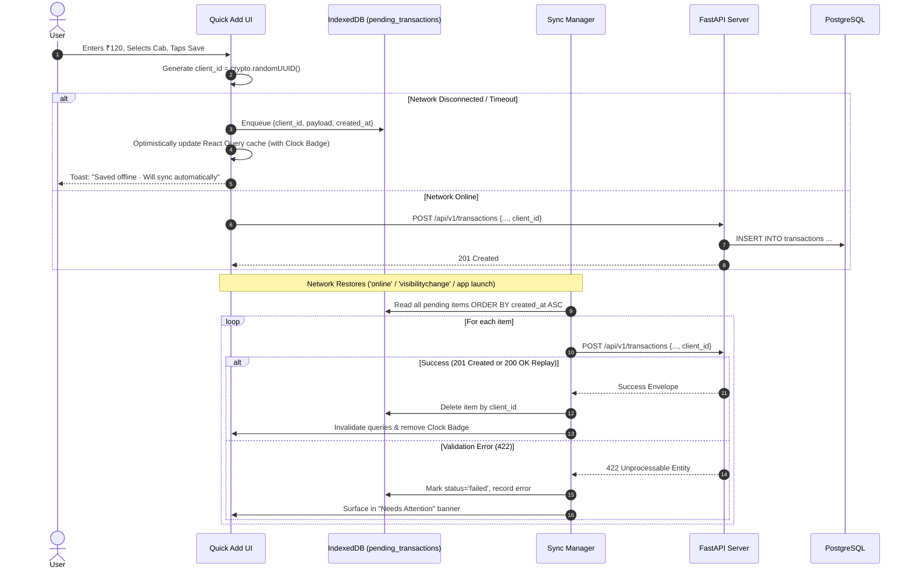

# SpendWise — Feature Specification: Offline Capabilities & PWA Runtime

## 1. Overview & Business Objective

SpendWise is engineered as an offline-first Progressive Web Application (PWA). Because mobile payments frequently occur in cellular dead zones (parking garages, basements, remote vendor stalls), the application guarantees that creating an expense never fails due to network disconnection.

---

## 2. User Stories

- **US-PWA-01:** As an iPhone user, I want to add SpendWise to my Home Screen so that it launches in standalone full-screen mode like a native iOS app.
- **US-PWA-02:** As a user paying cash in an underground shop without internet, I want to record my expense immediately and have it automatically synchronize when I regain connectivity.
- **US-PWA-03:** As a user reopening the app offline, I want the dashboard to load instantly from cached local data rather than displaying a blank error screen.
- **US-PWA-04:** As a user with pending offline expenses, I want to see a clear indicator on the dashboard so that I know my data is safe and waiting to sync.

---

## 3. Offline Synchronization Lifecycle



---

## 4. Functional Requirements & Business Logic

### 4.1 iOS Safari PWA Configuration (`index.html`)
To achieve true standalone native appearance on iPhone devices:
```html
<meta name="viewport" content="width=device-width, initial-scale=1, viewport-fit=cover" />
<meta name="apple-mobile-web-app-capable" content="yes" />
<meta name="apple-mobile-web-app-status-bar-style" content="black-translucent" />
<meta name="apple-mobile-web-app-title" content="SpendWise" />
<link rel="apple-touch-icon" href="/icons/apple-touch-icon-180.png" />
<link rel="manifest" href="/manifest.webmanifest" />
```

### 4.2 Web App Manifest (`manifest.webmanifest`)
- `name`: `"SpendWise — Expense Tracker"`
- `short_name`: `"SpendWise"`
- `start_url`: `"/?source=pwa"`
- `display`: `"standalone"`
- `orientation`: `"portrait"`
- `theme_color`: `"#4F46E5"` (light) / `"#0B0B12"` (dark)
- `shortcuts`: Includes quick action pointing directly to `"/add"`.

### 4.3 Service Worker (`src/sw.ts` - Workbox `injectManifest`)
- **Precaching:** Precaches the static app shell (HTML, bundled JS, CSS, Lucide icons, fonts).
- **Navigation Route:** Rewrites navigation requests to cached `index.html` (SPA fallback), excluding `/api/*`.
- **Runtime Caching:** `StaleWhileRevalidate` strategy for reference data: `GET /api/v1/categories` and `GET /api/v1/users/me`.
- **Exclusions:** Auth mutations (`/auth/*`), transaction mutations (`POST/PATCH/DELETE`), and file imports are **never cached** by the service worker.

### 4.4 IndexedDB Queue (`lib/offlineQueue.ts`)
- Utilizes the `idb` library with store name `pending_transactions`.
- Schema: `{ client_id: UUID, payload: object, created_at: string, attempts: number, last_error: string | null }`.
- **Sync Triggers:**
  1. Window `online` event.
  2. Document `visibilitychange` (state becomes `visible`).
  3. Cold application launch.
  4. W3C Background Sync API (`sync` event) where supported (fallback to steps 1–3 on iOS Safari).

### 4.5 v1 Offline Constraints
- **Creation Only:** Offline support in v1 is strictly limited to transaction **creation**.
- **Edits & Deletions:** Attempting to edit or delete existing transactions while offline displays a polite dialog: *"Connect to the internet to edit or delete existing expenses"*.

---

## 5. UI/UX States & Feedback

1. **Pending Clock Badge:** Transactions in the History list created offline render a subtle clock icon alongside the payment tag until synchronized with the server.
2. **Top Status Banner:** When disconnected, an amber banner floats beneath the status bar:
   `⚡ Offline: 2 expenses pending automatic sync`
3. **Install Guidance:** If the user opens the web app in iOS Safari outside standalone mode, a dismissible banner appears: *"Install SpendWise: tap Share → Add to Home Screen"*.

---

## 6. Testing Scenarios & Acceptance Criteria

1. **Offline Creation:** In Chrome DevTools / Playwright, set network offline; submit a ₹150 expense; verify record is written to IndexedDB and optimistic UI updates.
2. **Sequential Replay:** Set network online; verify the queue flushes sequentially in chronological order.
3. **Idempotent Replay:** Simulate a duplicated network packet with identical `client_id`; verify backend returns `200 OK` and client removes the item without creating a duplicate.
4. **Lighthouse Audit:** Assert PWA score ≥ 90 on production build.
