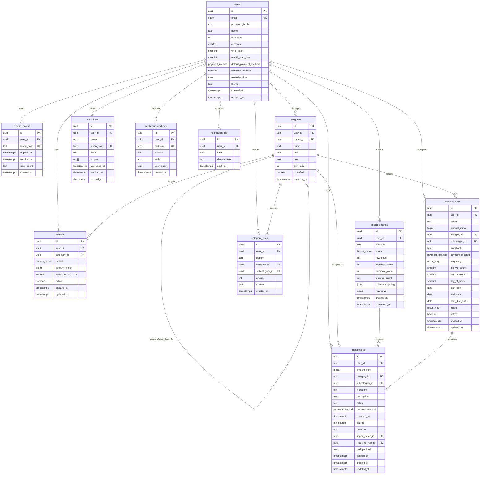

# SpendWise — Database & Relational Schema Specification

## 1. Database Overview & Conventions

SpendWise utilizes **PostgreSQL 16** as its primary relational datastore. The database is accessed asynchronously from FastAPI using **SQLAlchemy 2.0** and the **asyncpg** driver. All migrations are orchestrated through **Alembic**.

### 1.1 Core Conventions & Financial Guarantees
1. **Primary Keys:** UUID version 4 generated via PostgreSQL native `gen_random_uuid()`.
2. **Timestamps:** Every table contains `created_at TIMESTAMPTZ NOT NULL DEFAULT now()` and `updated_at TIMESTAMPTZ NOT NULL DEFAULT now()`. All timestamps are stored and evaluated in **UTC**.
3. **Monetary Representation:** Stored strictly as **paise** using 64-bit integers: `amount_minor BIGINT NOT NULL CHECK (amount_minor > 0)`. Floating-point types (`float`, `real`, `numeric` without paise scaling) are **strictly forbidden**.
4. **Tenant Isolation:** Every user-owned table includes `user_id UUID NOT NULL REFERENCES users(id) ON DELETE CASCADE`. Every analytical and transactional query must filter by `user_id`.
5. **Soft-Deletion:** Transactions utilize `deleted_at TIMESTAMPTZ NULL` to support one-tap undo actions. Analytical queries strictly enforce `WHERE deleted_at IS NULL`.
6. **Case-Insensitive Identifiers:** Email addresses utilize the PostgreSQL `citext` extension.
7. **Fuzzy Text Search:** Merchant and description queries utilize the `pg_trgm` extension.

---

## 2. Entity-Relationship Diagram (ERD)



---

## 3. Database Enumerations (ENUMs)

```sql
CREATE TYPE payment_method AS ENUM (
    'upi',
    'cash',
    'card',
    'bank_transfer',
    'other'
);

CREATE TYPE txn_source AS ENUM (
    'manual',
    'shortcut',
    'csv_import',
    'recurring'
);

CREATE TYPE budget_period AS ENUM (
    'weekly',
    'monthly'
);

CREATE TYPE recur_freq AS ENUM (
    'daily',
    'weekly',
    'monthly',
    'yearly'
);

CREATE TYPE recur_mode AS ENUM (
    'auto_create',
    'remind'
);

CREATE TYPE import_status AS ENUM (
    'uploaded',
    'mapped',
    'committed',
    'failed'
);
```

---

## 4. Complete Table Schemas & DDL

### 4.1 `users`
Represents registered individual user accounts and user-level preference profiles.

```sql
CREATE TABLE users (
    id UUID PRIMARY KEY DEFAULT gen_random_uuid(),
    email CITEXT UNIQUE NOT NULL,
    password_hash TEXT NOT NULL,
    name TEXT NULL,
    timezone TEXT NOT NULL DEFAULT 'Asia/Kolkata',
    currency CHAR(3) NOT NULL DEFAULT 'INR',
    week_start SMALLINT NOT NULL DEFAULT 1 CHECK (week_start BETWEEN 1 AND 7), -- 1=Monday, 7=Sunday
    month_start_day SMALLINT NOT NULL DEFAULT 1 CHECK (month_start_day BETWEEN 1 AND 28),
    default_payment_method payment_method NOT NULL DEFAULT 'upi',
    reminder_enabled BOOLEAN NOT NULL DEFAULT true,
    reminder_time TIME NOT NULL DEFAULT '21:00:00',
    theme TEXT NOT NULL DEFAULT 'system' CHECK (theme IN ('system', 'light', 'dark')),
    created_at TIMESTAMPTZ NOT NULL DEFAULT now(),
    updated_at TIMESTAMPTZ NOT NULL DEFAULT now()
);

CREATE INDEX idx_users_email ON users(email);
```

### 4.2 `refresh_tokens`
Stores cryptographically hashed refresh tokens for session rotation and reuse detection.

```sql
CREATE TABLE refresh_tokens (
    id UUID PRIMARY KEY DEFAULT gen_random_uuid(),
    user_id UUID NOT NULL REFERENCES users(id) ON DELETE CASCADE,
    token_hash TEXT UNIQUE NOT NULL,
    expires_at TIMESTAMPTZ NOT NULL,
    revoked_at TIMESTAMPTZ NULL,
    user_agent TEXT NULL,
    created_at TIMESTAMPTZ NOT NULL DEFAULT now()
);

CREATE INDEX idx_refresh_tokens_user_id ON refresh_tokens(user_id);
CREATE INDEX idx_refresh_tokens_hash ON refresh_tokens(token_hash);
```

### 4.3 `categories`
Two-level category tree (Category → Subcategory) scoped per user.

```sql
CREATE TABLE categories (
    id UUID PRIMARY KEY DEFAULT gen_random_uuid(),
    user_id UUID NOT NULL REFERENCES users(id) ON DELETE CASCADE,
    parent_id UUID NULL REFERENCES categories(id) ON DELETE CASCADE,
    name TEXT NOT NULL,
    icon TEXT NOT NULL,
    color TEXT NOT NULL,
    sort_order INT NOT NULL DEFAULT 0,
    is_default BOOLEAN NOT NULL DEFAULT false,
    archived_at TIMESTAMPTZ NULL,
    created_at TIMESTAMPTZ NOT NULL DEFAULT now()
);

-- Unique category name per user under the same parent (COALESCE for top-level nulls)
CREATE UNIQUE INDEX uq_categories_user_parent_name 
ON categories(user_id, COALESCE(parent_id, '00000000-0000-0000-0000-000000000000'::uuid), lower(name));

CREATE INDEX idx_categories_user_sort ON categories(user_id, sort_order ASC);
```

### 4.4 `transactions`
Core transaction ledger storing all expenditure records.

```sql
CREATE TABLE transactions (
    id UUID PRIMARY KEY DEFAULT gen_random_uuid(),
    user_id UUID NOT NULL REFERENCES users(id) ON DELETE CASCADE,
    amount_minor BIGINT NOT NULL CHECK (amount_minor > 0),
    category_id UUID NOT NULL REFERENCES categories(id) ON DELETE RESTRICT,
    subcategory_id UUID NULL REFERENCES categories(id) ON DELETE SET NULL,
    merchant TEXT NULL,
    description TEXT NULL,
    notes TEXT NULL,
    payment_method payment_method NOT NULL DEFAULT 'upi',
    occurred_at TIMESTAMPTZ NOT NULL DEFAULT now(),
    source txn_source NOT NULL DEFAULT 'manual',
    client_id UUID NULL,
    import_batch_id UUID NULL REFERENCES import_batches(id) ON DELETE SET NULL,
    recurring_rule_id UUID NULL REFERENCES recurring_rules(id) ON DELETE SET NULL,
    dedupe_hash TEXT NULL,
    deleted_at TIMESTAMPTZ NULL,
    created_at TIMESTAMPTZ NOT NULL DEFAULT now(),
    updated_at TIMESTAMPTZ NOT NULL DEFAULT now()
);

-- Idempotent client sync constraint
CREATE UNIQUE INDEX uq_transactions_user_client_id 
ON transactions(user_id, client_id) 
WHERE client_id IS NOT NULL;

-- Temporal query indexes (active records only)
CREATE INDEX idx_transactions_user_occurred 
ON transactions(user_id, occurred_at DESC) 
WHERE deleted_at IS NULL;

CREATE INDEX idx_transactions_user_cat_occurred 
ON transactions(user_id, category_id, occurred_at DESC) 
WHERE deleted_at IS NULL;

-- Deduplication index
CREATE INDEX idx_transactions_user_dedupe 
ON transactions(user_id, dedupe_hash);

-- Fuzzy search index via GIN trigrams
CREATE INDEX idx_transactions_trgm_search 
ON transactions USING gin ((coalesce(merchant, '') || ' ' || coalesce(description, '')) gin_trgm_ops)
WHERE deleted_at IS NULL;
```

### 4.5 `budgets`
Spending limits defined globally or for specific top-level categories.

```sql
CREATE TABLE budgets (
    id UUID PRIMARY KEY DEFAULT gen_random_uuid(),
    user_id UUID NOT NULL REFERENCES users(id) ON DELETE CASCADE,
    category_id UUID NULL REFERENCES categories(id) ON DELETE CASCADE, -- NULL indicates overall monthly budget
    period budget_period NOT NULL DEFAULT 'monthly',
    amount_minor BIGINT NOT NULL CHECK (amount_minor > 0),
    alert_threshold_pct SMALLINT NOT NULL DEFAULT 80 CHECK (alert_threshold_pct BETWEEN 50 AND 100),
    active BOOLEAN NOT NULL DEFAULT true,
    created_at TIMESTAMPTZ NOT NULL DEFAULT now(),
    updated_at TIMESTAMPTZ NOT NULL DEFAULT now()
);

-- Unique active budget per user, category, and period
CREATE UNIQUE INDEX uq_budgets_user_cat_period 
ON budgets(user_id, COALESCE(category_id, '00000000-0000-0000-0000-000000000000'::uuid), period)
WHERE active = true;
```

### 4.6 `recurring_rules`
Rules governing predictable recurring expenses.

```sql
CREATE TABLE recurring_rules (
    id UUID PRIMARY KEY DEFAULT gen_random_uuid(),
    user_id UUID NOT NULL REFERENCES users(id) ON DELETE CASCADE,
    name TEXT NOT NULL,
    amount_minor BIGINT NOT NULL CHECK (amount_minor > 0),
    category_id UUID NOT NULL REFERENCES categories(id) ON DELETE RESTRICT,
    subcategory_id UUID NULL REFERENCES categories(id) ON DELETE SET NULL,
    merchant TEXT NULL,
    payment_method payment_method NOT NULL DEFAULT 'upi',
    frequency recur_freq NOT NULL,
    interval_count SMALLINT NOT NULL DEFAULT 1 CHECK (interval_count > 0),
    day_of_month SMALLINT NULL CHECK (day_of_month BETWEEN 1 AND 31),
    day_of_week SMALLINT NULL CHECK (day_of_week BETWEEN 1 AND 7),
    start_date DATE NOT NULL,
    end_date DATE NULL,
    next_due_date DATE NOT NULL,
    mode recur_mode NOT NULL DEFAULT 'remind',
    active BOOLEAN NOT NULL DEFAULT true,
    created_at TIMESTAMPTZ NOT NULL DEFAULT now(),
    updated_at TIMESTAMPTZ NOT NULL DEFAULT now()
);

CREATE INDEX idx_recurring_rules_due ON recurring_rules(active, next_due_date);
```

### 4.7 `category_rules`
Merchant keyword matching rules for automated transaction classification.

```sql
CREATE TABLE category_rules (
    id UUID PRIMARY KEY DEFAULT gen_random_uuid(),
    user_id UUID NOT NULL REFERENCES users(id) ON DELETE CASCADE,
    pattern TEXT NOT NULL,
    category_id UUID NOT NULL REFERENCES categories(id) ON DELETE CASCADE,
    subcategory_id UUID NULL REFERENCES categories(id) ON DELETE SET NULL,
    priority INT NOT NULL DEFAULT 0,
    source TEXT NOT NULL DEFAULT 'user' CHECK (source IN ('user', 'learned')),
    created_at TIMESTAMPTZ NOT NULL DEFAULT now()
);

CREATE INDEX idx_category_rules_user ON category_rules(user_id, priority DESC);
```

### 4.8 `import_batches`
Tracks CSV file uploads, raw row staging, and execution metrics.

```sql
CREATE TABLE import_batches (
    id UUID PRIMARY KEY DEFAULT gen_random_uuid(),
    user_id UUID NOT NULL REFERENCES users(id) ON DELETE CASCADE,
    filename TEXT NOT NULL,
    status import_status NOT NULL DEFAULT 'uploaded',
    row_count INT NOT NULL DEFAULT 0,
    imported_count INT NOT NULL DEFAULT 0,
    duplicate_count INT NOT NULL DEFAULT 0,
    skipped_count INT NOT NULL DEFAULT 0,
    column_mapping JSONB NULL,
    raw_rows JSONB NULL,
    created_at TIMESTAMPTZ NOT NULL DEFAULT now(),
    committed_at TIMESTAMPTZ NULL
);

CREATE INDEX idx_import_batches_user ON import_batches(user_id, created_at DESC);
```

### 4.9 `api_tokens`
Cryptographically hashed API access tokens powering iOS Shortcut integrations.

```sql
CREATE TABLE api_tokens (
    id UUID PRIMARY KEY DEFAULT gen_random_uuid(),
    user_id UUID NOT NULL REFERENCES users(id) ON DELETE CASCADE,
    name TEXT NOT NULL,
    token_hash TEXT UNIQUE NOT NULL,
    last4 TEXT NOT NULL,
    scopes TEXT[] NOT NULL DEFAULT '{transactions:create}',
    last_used_at TIMESTAMPTZ NULL,
    revoked_at TIMESTAMPTZ NULL,
    created_at TIMESTAMPTZ NOT NULL DEFAULT now()
);

CREATE INDEX idx_api_tokens_hash ON api_tokens(token_hash);
```

### 4.10 `push_subscriptions`
Web Push API subscription endpoints for Apple APNs and Google FCM delivery.

```sql
CREATE TABLE push_subscriptions (
    id UUID PRIMARY KEY DEFAULT gen_random_uuid(),
    user_id UUID NOT NULL REFERENCES users(id) ON DELETE CASCADE,
    endpoint TEXT UNIQUE NOT NULL,
    p256dh TEXT NOT NULL,
    auth TEXT NOT NULL,
    user_agent TEXT NULL,
    created_at TIMESTAMPTZ NOT NULL DEFAULT now()
);

CREATE INDEX idx_push_subs_user ON push_subscriptions(user_id);
```

### 4.11 `notification_log`
Audit log of dispatched push alerts ensuring deduplicated notification delivery.

```sql
CREATE TABLE notification_log (
    id UUID PRIMARY KEY DEFAULT gen_random_uuid(),
    user_id UUID NOT NULL REFERENCES users(id) ON DELETE CASCADE,
    kind TEXT NOT NULL, -- 'daily_reminder' | 'budget_warning' | 'budget_exceeded' | 'recurring_due'
    dedupe_key TEXT NOT NULL,
    sent_at TIMESTAMPTZ NOT NULL DEFAULT now(),
    CONSTRAINT uq_notification_log_dedupe UNIQUE (user_id, kind, dedupe_key)
);
```

---

## 5. Seed Data Specifications

When a new user registers (`POST /auth/register`), the registration service seeds the following default categories and merchant categorization rules:

### 5.1 Default Categories Seed
| Category Name | Icon | Hex Color | Seeded Subcategories |
|---|---|---|---|
| **Food & Dining** | `utensils` | `#F97316` | Restaurant, Cafe, Delivery |
| **Transportation** | `car` | `#3B82F6` | Auto, Cab, Bus, Train, Fuel |
| **Groceries** | `shopping-basket` | `#22C55E` | Vegetables, Household |
| **Shopping** | `shopping-bag` | `#A855F7` | Clothes, Electronics |
| **Bills** | `receipt` | `#EAB308` | Electricity, Internet, Mobile |
| **Housing** | `home` | `#14B8A6` | Rent, Maintenance |
| **Entertainment** | `film` | `#EC4899` | Movies, Games |
| **Healthcare** | `heart-pulse` | `#EF4444` | Medicine, Doctor |
| **Travel** | `plane` | `#06B6D4` | Hotels, Tickets |
| **Others** | `circle-ellipsis`| `#64748B` | Miscellaneous |

### 5.2 Default Category Rules Seed (Priority 0, Source 'user')
- `uber`, `ola`, `rapido` → Transportation / Cab
- `swiggy`, `zomato` → Food & Dining / Delivery
- `bigbasket`, `blinkit`, `zepto`, `dmart` → Groceries
- `amazon`, `flipkart`, `myntra` → Shopping
- `airtel`, `jio`, `vi`, `bsnl` → Bills / Mobile
- `bescom`, `mseb`, `tata power`, `adani electricity` → Bills / Electricity
- `irctc` → Travel / Tickets
- `bookmyshow` → Entertainment / Movies
- `apollo`, `medplus`, `pharmeasy` → Healthcare / Medicine

---

## 6. Future Phase 3 & 4 Tables (Schema-Ready)

To ensure smooth future evolution without breaking structural migrations, the following tables are provisioned in migration sets:

```sql
CREATE TYPE account_type AS ENUM ('cash', 'bank', 'card', 'wallet');

CREATE TABLE accounts (
    id UUID PRIMARY KEY DEFAULT gen_random_uuid(),
    user_id UUID NOT NULL REFERENCES users(id) ON DELETE CASCADE,
    name TEXT NOT NULL,
    type account_type NOT NULL DEFAULT 'bank',
    opening_balance_minor BIGINT NOT NULL DEFAULT 0,
    archived_at TIMESTAMPTZ NULL,
    created_at TIMESTAMPTZ NOT NULL DEFAULT now(),
    updated_at TIMESTAMPTZ NOT NULL DEFAULT now()
);

CREATE TABLE goals (
    id UUID PRIMARY KEY DEFAULT gen_random_uuid(),
    user_id UUID NOT NULL REFERENCES users(id) ON DELETE CASCADE,
    name TEXT NOT NULL,
    target_minor BIGINT NOT NULL CHECK (target_minor > 0),
    saved_minor BIGINT NOT NULL DEFAULT 0,
    target_date DATE NULL,
    created_at TIMESTAMPTZ NOT NULL DEFAULT now(),
    updated_at TIMESTAMPTZ NOT NULL DEFAULT now()
);

-- In the same migration set, transactions gets:
-- ALTER TABLE transactions ADD COLUMN account_id UUID NULL REFERENCES accounts(id) ON DELETE SET NULL;
```
*Note: These Phase 3/4 entities have no active UI or routes in v1.*
