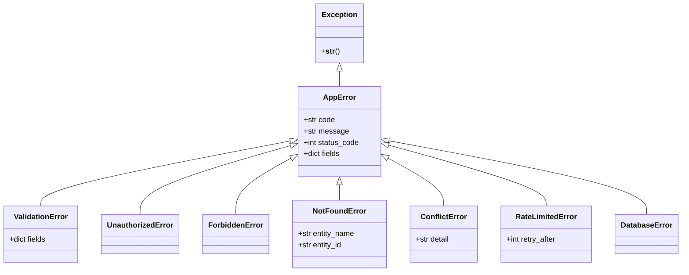

# SpendWise — Error Handling & Exception Architecture

## 1. Error Handling Philosophy

SpendWise enforces a deterministic, user-friendly, and secure error handling contract across both backend services and frontend interfaces. 

Core principles:
1. **Predictable Wire Format:** Every non-2xx HTTP response from the backend returns a standardized JSON envelope.
2. **Actionable User Guidance:** Error messages surfaced on mobile clients must clearly explain what went wrong and how the user can resolve it, without exposing internal stack traces.
3. **No Information Leakage:** Production error responses must never expose raw database queries, table names, file paths, or internal tracebacks.
4. **Resilient Client Boundaries:** Client-side errors in one component (e.g., an individual analytics chart) must never crash the entire application shell.

---

## 2. Standard Error Response Envelope

All API error responses adhere to the following unified JSON schema:

```json
{
  "error": {
    "code": "validation_error",
    "message": "The transaction amount must be greater than zero.",
    "fields": {
      "amount_minor": "must be > 0"
    },
    "request_id": "req_01HV8Z79XW2P9M0B2A4Q"
  }
}
```

### 2.1 Error Envelope Schema Attributes
- `code` *(string, required)*: Machine-readable error code in `snake_case`.
- `message` *(string, required)*: Human-readable explanation suitable for user display.
- `fields` *(object, optional)*: Key-value map of specific form or payload fields that failed validation.
- `request_id` *(string, required)*: Correlation identifier for tracing in server logs.

---

## 3. Backend Exception Hierarchy

The backend implements an explicit exception hierarchy rooted in `AppError` (`backend/app/core/errors.py`):



### 3.1 Exception Mapping Matrix

| Exception Class | HTTP Status | Standard Code | Typical Scenario |
|---|---|---|---|
| `ValidationError` | 422 | `validation_error` | Amount ≤ 0, future date > 5 min, unparseable date in CSV. |
| `UnauthorizedError` | 401 | `unauthorized` | Expired access JWT, invalid password, missing token. |
| `ForbiddenError` | 403 | `forbidden` | API token missing `transactions:create` scope. |
| `NotFoundError` | 404 | `not_found` | Transaction ID does not exist or belongs to another user. |
| `ConflictError` | 409 | `conflict` | Email already registered, category deletion with active transactions. |
| `RateLimitedError` | 429 | `rate_limited` | Exceeded 10 auth requests/min or 120 API calls/min. |
| `DatabaseError` | 500 | `server_error` | Unhandled database connection failure or deadlocks. |

---

## 4. Specialized Error Scenarios

### 4.1 CSV Statement Import Errors
CSV files frequently suffer from corrupt rows, invalid date formatting, and missing amounts. Rather than aborting the entire upload silently, the backend provides detailed row-level diagnostic feedback:

- **Upload Stage (`POST /imports`):**
  - If the file exceeds 2 MB → `413 Payload Too Large` (`code: "file_too_large"`).
  - If the file is not a valid CSV/text file → `422 Unprocessable Entity` (`code: "invalid_file_type"`).
  - If the file contains > 5,000 rows → `422 Unprocessable Entity` (`code: "too_many_rows"`).
- **Preview Stage (`POST /imports/{id}/preview`):**
  - Individual malformed rows receive an `error` attribute in the returned row list (e.g., `"Unparseable amount string: 'N/A'"` or `"Invalid date format for '31/02/2026'"`).
  - The wizard disables selection checkboxes for errored rows and highlights them in amber/red in the review table.

### 4.2 Offline & Network Errors
When the mobile client loses network connectivity:
- `fetch` calls fail with `TypeError: Failed to fetch` or timeout.
- The client `lib/api.ts` wrapper wraps this into an `OfflineNetworkError`.
- For transaction creation, `useCreateTransaction` catches `OfflineNetworkError`, serializes the payload into IndexedDB `pending_transactions`, and renders an optimistic card with a pending clock badge.
- For queries, TanStack Query catches the error, serves stale data from the persisted IndexedDB cache, and renders a top status banner: *"Offline — Viewing cached data"*.

---

## 5. Correlation IDs & Request Tracing

To ensure rapid debugging of production issues without compromising privacy:
1. **Middleware Generation:** An ASGI middleware in `backend/app/main.py` inspects incoming requests for an `X-Request-ID` header. If absent, it generates a unique identifier using `secrets.token_urlsafe(16)`.
2. **Context Binding:** The correlation ID is attached to the Python `contextvars` context and injected into every log record.
3. **Response Header:** The header is returned to the client in `X-Request-ID`.
4. **Error Envelope Inclusion:** The correlation ID is included in the `request_id` field of every error envelope, allowing users to report specific request IDs for investigation.

---

## 6. Frontend Error Boundaries & User Feedback

### 6.1 React Error Boundaries
The client application wraps critical layout zones in React Error Boundaries (`<ErrorBoundary fallback={...}>`):
1. **Root Boundary:** Catches catastrophic startup failures; renders a clean screen with an *"App encountered an error"* heading and a *"Reload SpendWise"* button.
2. **Chart Boundary:** Wraps Recharts components in the Dashboard and Analytics tabs. If a chart fails to render due to unexpected data shapes, the boundary renders an accessible HTML fallback table without crashing the navigation or summary cards.
3. **Sheet Boundary:** Wraps bottom sheet dialogs (Quick Add, Edit Sheet).

### 6.2 Toast Notifications & Undo Mechanisms
- **Delete Feedback:** Deleting a transaction immediately updates the list optimistically and triggers a Toast: *"Transaction deleted · Undo"*. Tapping "Undo" invokes `POST /transactions/{id}/restore`.
- **Validation Feedback:** Form errors in Quick Add render inline beneath the custom keypad or chip row rather than in disruptive modal popups.

---

## 7. User-Facing Error Copy Guide

To ensure consistent, friendly tone across the application, use these established copy templates:

| Technical Condition | User-Facing Message |
|---|---|
| Network disconnected during save | *"Saved offline. Your expense will automatically sync when you're back online."* |
| Login credentials incorrect | *"Incorrect email or password. Please double-check and try again."* |
| Password too common | *"This password is too easy to guess. Please choose a stronger password with at least 8 characters."* |
| Category has transactions | *"This category cannot be deleted because it contains transactions. You can archive it or reassign its transactions to another category."* |
| Rate limit exceeded | *"Too many requests. Please wait a minute before trying again."* |
| Statement import failure | *"We couldn't read your CSV file. Please make sure it's a valid bank statement under 2 MB."* |
