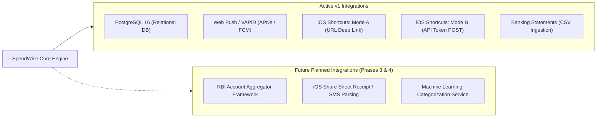

# SpendWise — External Integrations & Boundary Interfaces

## 1. Overview & Integration Boundaries

SpendWise interacts with external operating systems, file formats, and notification services through strictly defined, security-conscious interfaces. 



> [!CRITICAL]
> **Platform Boundary Rule:** SpendWise does **NOT** and **CANNOT** independently read Google Pay, PhonePe, Paytm, or bank SMS messages on iOS due to Apple's sandbox security model. All integrations documented below operate within supported web and OS boundaries.

---

## 2. PostgreSQL 16 Relational Database

### 2.1 Connection Architecture
- **Driver:** `asyncpg` combined with SQLAlchemy 2.0 Async Engine.
- **Connection Pooling:**
  - `pool_size`: 10 connections.
  - `max_overflow`: 20 connections.
  - `pool_timeout`: 30 seconds.
  - `pool_pre_ping`: True (validates connections before checkout, recovering from transient drops).
- **Required Extensions:**
  - `citext`: Case-insensitive text types for email fields.
  - `pg_trgm`: Trigram indexing for fast, typo-tolerant search across transaction descriptions and merchants.

---

## 3. Web Push Notifications (VAPID / pywebpush)

SpendWise utilizes the standard W3C Push API and IETF RFC 8291/8292 Voluntary Application Server Identification (VAPID) to dispatch push notifications to mobile and desktop devices without requiring third-party messaging SDKs.

### 3.1 Supported Push Gateways
- **Apple Push Notification service (APNs):** Delivers notifications to iOS / iPadOS Safari (version 16.4+) when SpendWise is installed to the Home Screen (standalone PWA mode).
- **Google Firebase Cloud Messaging (FCM):** Delivers notifications to Android Chrome and desktop browsers.

### 3.2 Subscription Flow
1. User taps *"Enable Reminders"* in `/settings`.
2. Frontend requests permission via `Notification.requestPermission()`.
3. If granted, the service worker calls `registration.pushManager.subscribe({ userVisibleOnly: true, applicationServerKey: VAPID_PUBLIC_KEY })`.
4. The client dispatches the resulting `PushSubscription` JSON to `POST /api/v1/push/subscribe`.
5. Backend stores `endpoint`, `p256dh`, and `auth` keys in the `push_subscriptions` table.

### 3.3 Message Types Dispatched
- **Daily Logging Reminder:** Dispatched at user's local `reminder_time` (default 21:00) if zero transactions were logged today.
- **Budget Threshold Warning:** Dispatched when spending reaches ≥ 80% (or custom threshold) of a budget.
- **Budget Exceeded Alert:** Dispatched when spending reaches ≥ 100% of a budget.
- **Recurring Payment Due:** Dispatched at 09:00 user-local on the due date of a recurring expense configured in `remind` mode.

---

## 4. Apple iOS Shortcuts Integration

To reduce expense entry friction to the absolute minimum, SpendWise supports two integration modes with the native iOS Shortcuts application.

### 4.1 Mode A: Deep Link with Prefill (Zero Token Configuration)
- **Mechanism:** Leverages an iOS Personal Automation:
  - *Trigger:* When Google Pay / PhonePe / Paytm is closed.
  - *Action:* "Open URL" → `https://app.spendwise.in/add?source=shortcut`
- **Prefill Parameter Support:**
  - The `/add` URL supports optional query parameters:
    - `amount`: Numeric string (e.g., `150.50`).
    - `category`: Category name (case-insensitive, matched against user's categories).
    - `merchant`: Merchant string (e.g., `Blinkit`).
    - `pm`: Payment method (`upi`, `cash`, `card`, `bank_transfer`).
    - `source`: Literal `"shortcut"`.
  - *Example:* `https://app.spendwise.in/add?amount=240&category=Food%20%26%20Dining&merchant=Swiggy&pm=upi`
- **Validation:** The frontend validates all query parameters. Invalid amounts or non-existent categories are ignored, safely falling back to user selection.

### 4.2 Mode B: Headless Direct API Integration (Personal API Token)
For advanced iOS power-users who want to log transactions without opening the browser:
- **Authentication:** Personal API Token generated in `/settings/shortcuts` (format: `sw_<32_random_bytes>`).
- **Endpoint:** `POST /api/v1/shortcuts/transactions`
- **Headers:** `Authorization: Bearer sw_...`, `Content-Type: application/json`
- **Request Payload:**
```json
{
  "amount": "150",
  "category": "Food & Dining",
  "merchant": "Saravana Bhavan",
  "payment_method": "upi",
  "note": "Quick breakfast"
}
```
- **Response:**
```json
{
  "id": "550e8400-e29b-41d4-a716-446655440000",
  "message": "₹150 added to Food & Dining"
}
```
- **Shortcut Actions:**
  1. *Ask for Input (Number):* "How much did you spend?"
  2. *Choose from Menu:* Food, Transport, Shopping, Bills, Other.
  3. *Get Contents of URL:* POST to SpendWise API with Bearer token.
  4. *Show Notification:* Displays the returned `message` text.

---

## 5. CSV Statement File Formats

SpendWise's statement import engine is tested and certified against standard CSV formats exported by Indian financial institutions:

### 5.1 Supported Institution Formats
| Source | Typical Columns | Dialect / Date Format | Amount Handling |
|---|---|---|---|
| **HDFC Bank** | Date, Narration, Chq/Ref No, Value Dt, Withdrawal Amt, Deposit Amt, Closing Balance | Comma, `DD/MM/YYYY` | Split Debit/Credit columns |
| **State Bank of India (SBI)** | Txn Date, Value Date, Description, Ref No/Cheque No, Debit, Credit, Balance | Comma, `DD MMM YYYY` | Split Debit/Credit columns |
| **ICICI Bank** | Transaction Date, Value Date, Cheque Number, Transaction Remarks, Debit Amount, Credit Amount, Balance | Comma, `DD-MM-YYYY` | Split Debit/Credit columns |
| **Google Pay Statement** | Date, Transaction ID, Description, Amount, Payment Method, Status | Comma, `YYYY-MM-DD` | Single signed amount or positive expense column |
| **Paytm Statement** | Date, Time, Transaction Details, Amount, Debit/Credit | Comma, `DD/MM/YYYY HH:mm:ss` | Amount with Dr/Cr signifier column |

---

## 6. Future Integrations (Phase 3 & Phase 4 Roadmap)

The following integrations are intentionally excluded from v1 to prioritize fast manual entry, but are planned for subsequent phases:

1. **Account Aggregator (AA) Ecosystem (Phase 4):**
   - Integration with RBI-licensed Account Aggregators (e.g., Setu, Anumati) to fetch consented bank statements automatically.
   - Will require explicit user consent, OTP-based verification, and bank-specific linking.
2. **iOS Share Sheet Text Parser (Phase 4):**
   - iOS Shortcut that receives copied UPI transactional SMS text via the iOS Share Sheet and regex-parses the amount and merchant before dispatching to `/shortcuts/transactions`.
3. **Machine Learning Categorization Pipeline (Phase 3):**
   - Advanced text embeddings to classify merchant strings that do not match predefined substring rules.
