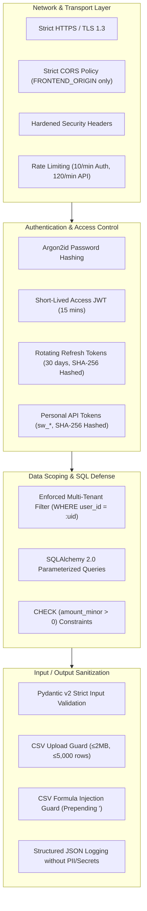

# SpendWise — Security & Data Protection Specification

## 1. Security Architecture Overview

SpendWise is engineered with a multi-layered defense-in-depth posture. Because SpendWise tracks personal financial outflows, security and privacy are treated as paramount architectural invariants rather than secondary considerations.



---

## 2. Authentication & Credential Architecture

### 2.1 Password Security (Argon2id)
- **Algorithm:** Argon2id (`argon2-cffi`), the state-of-the-art memory-hard hashing algorithm.
- **Parameters:**
  - Time Cost (`iterations`): 3
  - Memory Cost: 65,536 KiB (64 MiB)
  - Parallelism: 4 threads
- **Password Policies:**
  - Minimum length: 8 characters.
  - Blacklist validation: Automatically rejects passwords matching the top 1,000 most common passwords (bundled static dictionary).

### 2.2 Access Token (JWT) Lifecycle
- **Algorithm:** HMAC-SHA256 (`HS256`).
- **Secret Key:** `JWT_SECRET` (minimum 32-byte high-entropy string loaded from environment).
- **TTL (Time-To-Live):** 15 minutes.
- **Claims:**
  - `sub`: User UUID (`users.id`).
  - `iat`: Issued-at timestamp (UTC).
  - `exp`: Expiration timestamp (UTC).
  - `type`: Literal string `"access"`.
- **Storage:** Client holds the access token strictly **in memory** (React state / closure variable). It is never stored in `localStorage` or `sessionStorage`.

### 2.3 Refresh Token Rotation & Reuse Detection
- **Entropy:** 32 cryptographically secure random bytes generated via `secrets.token_hex(32)`.
- **Storage:** Stored in the database strictly as a **SHA-256 hash** (`refresh_tokens.token_hash`). Plaintext tokens are never stored.
- **Client Storage:** Retained in `localStorage` to ensure standalone iOS PWA sessions survive app termination.
- **Rotation Protocol:**
  - Upon calling `POST /api/v1/auth/refresh`, the submitted refresh token is immediately marked revoked (`revoked_at = now()`).
  - A new refresh token is issued and returned alongside the new access JWT.
  - **Automatic Breach Neutralization:** If a request presents a refresh token that has already been revoked, the backend assumes token theft, revokes **all active refresh tokens for that user**, and terminates all sessions.

### 2.4 Personal API Tokens (iOS Shortcuts)
- **Format:** `sw_` followed by 32 URL-safe base64 random bytes (e.g., `sw_9b8a7c6d5e4f3a2b1c0d9e8f7a6b5c4d`).
- **Database Storage:** Stored strictly as a SHA-256 hash (`token_hash`) along with the `last4` characters for identification.
- **Display Rule:** Plaintext token is displayed **only once** upon creation in the UI.
- **Scope Restriction:** Tokens are strictly scoped to `"transactions:create"`. They cannot read transactions, access analytics, modify categories, or access user settings.

---

## 3. Authorization & Tenant Data Isolation

### 3.1 Uncompromising User Scoping
SpendWise operates a multi-tenant relational schema. Complete data isolation between users is guaranteed through the following rules:

1. **Every user-owned table has a mandatory `user_id` column:**
   ```sql
   user_id UUID NOT NULL REFERENCES users(id) ON DELETE CASCADE
   ```
2. **Every query must explicitly bind `user_id`:**
   - The user ID is extracted directly from the authenticated JWT token via `deps.get_current_user`.
   - The query filter is applied at the service layer:
     ```python
     stmt = select(Transaction).where(
         Transaction.user_id == current_user.id,
         Transaction.id == transaction_id,
         Transaction.deleted_at.is_(None)
     )
     ```
3. **No Cross-User Leakage:** A user querying `/transactions/{id}` belonging to another user receives a `404 Not Found` (never `403 Forbidden`, preventing resource existence enumeration).

---

## 4. Injection Defenses & Input Validation

### 4.1 SQL Injection Prevention
- All relational operations utilize **SQLAlchemy 2.0 ORM** or parameterized `text()` constructs.
- Dynamic string concatenation into SQL statements is strictly prohibited.
- All database parameters are transmitted via asyncpg binary protocol bindings.

### 4.2 CSV Formula Injection Defense (CSV / Excel Export)
When exporting data to CSV or Excel, malicious user input in transaction notes or descriptions (e.g., `=cmd|' /C calc'!A0` or `@SUM(...)`) could execute remote commands in spreadsheet applications.
- **Export Rule:** Any exported string cell starting with `=`, `+`, `-`, or `@` is automatically sanitized by prefixing with a single quote (`'`), neutralizing spreadsheet formula execution.

### 4.3 CSV Upload Safety
- Files uploaded to `POST /api/v1/imports` are restricted to:
  - File extension: `.csv`
  - MIME type: `text/csv`, `text/plain`, `application/vnd.ms-excel`
  - Maximum file size: **2 MB**.
  - Maximum row count: **5,000 rows**.
- Files are parsed in-memory with strict row iteration limits, preventing Zip bomb or memory exhaustion attacks.

### 4.4 Cross-Site Scripting (XSS)
- React 18 automatically escapes all interpolated variables in JSX.
- Dangerous methods (`dangerouslySetInnerHTML`) are strictly prohibited in the codebase.
- User input in merchant, description, and notes fields is stored as clean text without HTML rendering.

---

## 5. Network & Transport Security

### 5.1 Transport Layer Security (TLS)
- All production traffic requires **HTTPS** with TLS 1.3 / TLS 1.2.
- HTTP traffic is automatically redirected to HTTPS with a `301 Moved Permanently`.

### 5.2 Cross-Origin Resource Sharing (CORS)
- FastAPI CORS middleware is locked exclusively to `FRONTEND_ORIGIN` (e.g., `https://app.spendwise.in`).
- Wildcards (`allow_origins=["*"]`) and permissive origins are rejected in production configurations.
- Allowed headers: `Authorization`, `Content-Type`. Allowed methods: `GET`, `POST`, `PATCH`, `PUT`, `DELETE`.

### 5.3 Hardened HTTP Security Headers
Every HTTP response dispatched by the API gateway and static frontend web server includes:

```http
Strict-Transport-Security: max-age=63072000; includeSubDomains; preload
X-Content-Type-Options: nosniff
X-Frame-Options: DENY
Referrer-Policy: strict-origin-when-cross-origin
Content-Security-Policy: default-src 'self'; script-src 'self'; style-src 'self' 'unsafe-inline'; img-src 'self' data:; connect-src 'self' https://<api-domain>; font-src 'self';
Permissions-Policy: camera=(), microphone=(), geolocation=(), payment=()
```

### 5.4 Rate Limiting
- **Authentication Routes (`/auth/login`, `/auth/register`):** 10 requests per minute per IP address.
- **Shortcuts Route (`/shortcuts/transactions`):** 30 requests per minute per API token.
- **General API Routes:** 120 requests per minute per authenticated user ID.

---

## 6. Logging, Auditing & Privacy Restrictions

### 6.1 Strict Logging Filters
SpendWise utilizes structured JSON logging via Python `logging`.
- **FORBIDDEN IN LOGS:**
  - Plaintext passwords or current passwords.
  - Password hashes.
  - Plaintext refresh tokens or JWTs.
  - VAPID private keys.
  - Credit/debit card details (card numbers, CVV).
  - PII (user emails combined with monetary transaction amounts).
- Request payloads on `/auth/*` routes are excluded from debug logging.

### 6.2 Data Privacy & Right to Erasure
- **Zero Third-Party Trackers:** SpendWise contains no Google Analytics, Meta Pixel, or third-party behavioral trackers.
- **Account Erasure (`DELETE /users/me`):** Hard-deletes the user's database row, triggering cascading deletions across `transactions`, `categories`, `budgets`, `recurring_rules`, `refresh_tokens`, and `api_tokens`. Associated import batches and notification logs are completely purged.

---

## 7. Security Acceptance Criteria

1. **Automated User Isolation Test Suite:**
   - 100% of API endpoints must pass automated tests verifying that User A cannot read, create, update, or delete User B's resources.
2. **Password Security:**
   - Attempting to register with `password123` is rejected with `422 Unprocessable Entity`.
3. **Token Rotation:**
   - Submitting an already rotated refresh token revokes all tokens for that user account and forces re-authentication.
4. **Formula Injection Sanitization:**
   - A transaction with merchant `=SUM(1,2)` exports to CSV as `'=SUM(1,2)`.
5. **CORS Enforcement:**
   - Origin headers outside `FRONTEND_ORIGIN` receive `403 Forbidden` on preflight `OPTIONS` requests.
